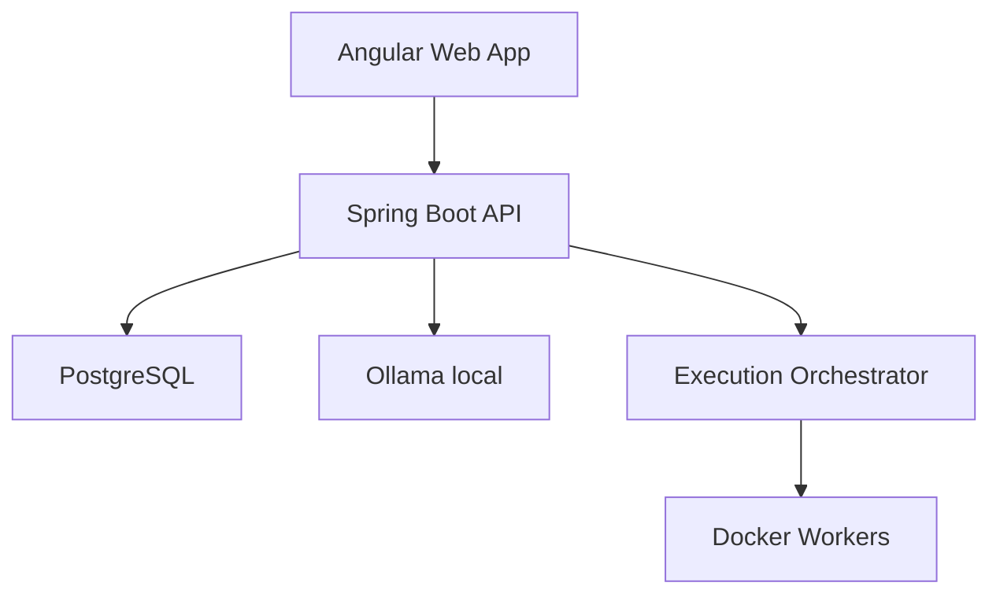
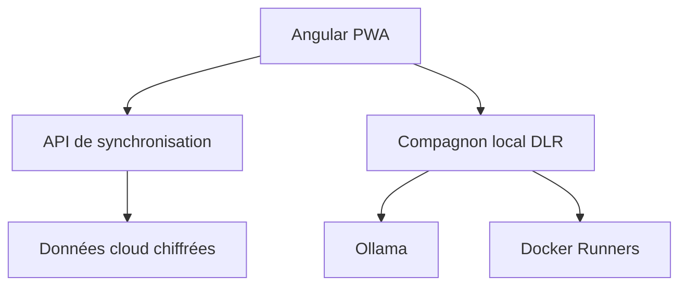

# DLR — Deep Learning & Review

## Document d'implémentation — Version 1.0

**Document associé :** [`DLR_Conception.md`](DLR_Conception.md)  
**Architecture :** application web responsive, local-first  
**Stack :** Java, Spring Boot, Angular, TypeScript, PostgreSQL, Ollama, API DeepSeek et Docker  
**Cible initiale :** utilisateur unique

---

## 1. Objectif du document

Ce document traduit la conception fonctionnelle de DLR en plan de réalisation technique. Il fixe l'architecture, les modules, les conventions, le modèle de données, les API, l'intégration Ollama, l'exécution sécurisée du code, les tests et l'ordre de développement.

Le principe directeur est de construire un monolithe modulaire pour la V1. Cette approche reste assez simple pour apprendre et livrer rapidement, tout en imposant des frontières métier claires qui permettront d'extraire certains composants plus tard si nécessaire.

## 2. Choix techniques

| Domaine | Choix initial | Justification |
|---|---|---|
| Backend | Java 21 + Spring Boot | renforcer Java moderne et les compétences recherchées en emploi |
| Frontend | Angular + TypeScript strict | apprendre TypeScript dans un cadre professionnel structuré |
| Expérience installable | Angular PWA + Service Worker | installation sur PC/mobile, cache applicatif et démarrage rapide |
| Base de données | PostgreSQL | base relationnelle robuste, SQL standard et bonne intégration JPA |
| Migrations | Flyway | schéma versionné et reproductible |
| ORM | Spring Data JPA + Hibernate | pratique professionnelle de la persistance Java |
| IA | Ollama local | confidentialité, absence de coût par requête et fonctionnement local |
| Éditeur | CodeMirror 6 | éditeur modulaire et léger, coloration multilangage et saisie fiable sur tous les navigateurs (remplace Monaco depuis la V3.10) |
| Exécution | Docker Engine + workers | isolation des programmes Java, Python et TypeScript |
| Tests backend | JUnit 5, AssertJ, Mockito, Testcontainers | tests unitaires et intégration réelle avec PostgreSQL |
| Tests frontend | Vitest/Jasmine selon Angular, Testing Library, Playwright | tests de composants et parcours complets |
| Documentation API | OpenAPI/Swagger | contrat lisible et testable |
| Build | Maven pour le backend, Angular CLI/npm pour le frontend | outils standards des écosystèmes retenus |

Les versions exactes seront verrouillées lors de l'initialisation afin d'utiliser des versions stables et compatibles au moment du développement.

## 3. Architecture générale



### 3.1 Responsabilités

- **Angular** affiche les parcours, l'éditeur, les quiz, le calendrier et les statistiques.
- **Spring Boot** porte toutes les règles métier, calcule les scores et orchestre les services.
- **PostgreSQL** conserve le contenu pédagogique, les tentatives et la progression.
- **Ollama** fournit les explications, analyses qualitatives et défis adaptatifs.
- **Docker Workers** compilent, exécutent et testent le code dans un environnement limité.

## 4. Structure du dépôt

```text
dlr/
├── apps/
│   ├── api/
│   └── web/
├── runners/
│   ├── java-runner/
│   ├── python-runner/
│   └── typescript-runner/
├── content/
│   ├── java/
│   ├── python/
│   └── typescript/
├── infrastructure/
│   ├── docker/
│   └── scripts/
├── docs/
│   ├── DLR_Conception.md
│   ├── DLR_Implementation.md
│   └── DLR_CodeReview.md
├── compose.yaml
└── README.md
```

Le contenu des laboratoires est maintenu dans des fichiers versionnés puis importé dans PostgreSQL. Le code applicatif et le contenu pédagogique peuvent ainsi évoluer séparément.

## 5. Architecture backend

### 5.1 Style retenu

Le backend utilise un monolithe modulaire inspiré de l'architecture hexagonale :

- `domain` : objets métier et règles indépendantes du framework ;
- `application` : cas d'utilisation et orchestration ;
- `infrastructure` : JPA, Ollama, Docker et services externes ;
- `web` : contrôleurs REST, requêtes, réponses et gestion des erreurs.

### 5.2 Packages proposés

```text
com.dlr
├── catalog
├── learning
├── assessment
├── mastery
├── planning
├── gamification
├── tutor
├── execution
├── analytics
└── shared
```

Chaque module possède ses propres sous-packages `domain`, `application`, `infrastructure` et `web`. Une classe d'un module ne doit pas accéder directement au repository d'un autre module ; elle passe par un service applicatif public.

### 5.3 Modules backend

| Module | Responsabilités |
|---|---|
| `catalog` | langages, laboratoires, leçons, concepts clés et prérequis |
| `learning` | inscriptions, progression, sessions et tentatives |
| `assessment` | tests, quiz, checklists, scores et validations |
| `mastery` | maîtrise des concepts et répétition espacée |
| `planning` | calendrier, rythme 3/4 mois et rattrapage |
| `gamification` | XP, niveaux, badges, séries et récompenses |
| `tutor` | prompts, contexte, réponses et disponibilité Ollama |
| `execution` | soumissions, files d'attente, runners et résultats |
| `analytics` | agrégats, tendances, forces et faiblesses |

## 6. Architecture frontend

### 6.1 Structure Angular

```text
src/app/
├── core/
├── shared/
├── features/
│   ├── dashboard/
│   ├── paths/
│   ├── lab-workspace/
│   ├── key-concepts/
│   ├── reviews/
│   ├── calendar/
│   ├── achievements/
│   └── settings/
└── app.routes.ts
```

### 6.2 Principes Angular

- composants standalone ;
- TypeScript en mode strict ;
- Signals pour l'état local et dérivé ;
- RxJS pour les flux asynchrones et HTTP ;
- lazy loading par fonctionnalité ;
- services d'accès API séparés des composants ;
- formulaires réactifs ;
- aucune règle de score calculée uniquement dans le navigateur.

### 6.3 Écrans principaux

1. **Onboarding** : objectif, planning, récompenses et connexion Ollama.
2. **Tableau de bord** : séance du jour, progression, série, XP et alertes.
3. **Parcours** : carte des 24 activités et prérequis.
4. **Laboratoire** : théorie, concept clé, éditeur, tests, quiz et bilan.
5. **Concepts clés** : graphe de connexions, maîtrise et révisions.
6. **Calendrier** : séances prévues/réelles et rattrapages.
7. **Statistiques** : temps, scores, erreurs, tendances et faiblesses.
8. **Paramètres** : Ollama, runners, données et sauvegarde.

### 6.4 Direction artistique : professionnelle et ludique

L'interface doit donner l'impression d'un véritable environnement de développement et de progression professionnelle, sans ressembler à un tableau administratif froid. La partie ludique soutient la motivation, mais ne doit jamais masquer le contenu ni transformer la formation en jeu superficiel.

Principes visuels :

- hiérarchie nette, espaces généreux et densité réglable ;
- cartes de parcours inspirées d'une carte de progression, sans surcharge graphique ;
- animations courtes pour les réussites, niveaux et transitions ;
- graphiques sobres pour les scores, le temps et la maîtrise ;
- couleurs de statut cohérentes : découverte, en cours, acquis, solide et maîtrisé ;
- micro-récompenses visuelles après un effort vérifiable ;
- éditeur de code au centre de l'expérience pratique ;
- possibilité de réduire ou désactiver les animations ;
- aucune animation bloquante pendant une séance concentrée.

Le design system utilise des tokens CSS pour les couleurs, espacements, rayons, ombres, typographies et durées d'animation. Les composants ne doivent pas contenir directement des couleurs fixes.

### 6.5 Thèmes et confort visuel

L'utilisateur peut sélectionner au minimum :

1. **Système** : suit automatiquement le thème du système d'exploitation ;
2. **Clair professionnel** : fond légèrement cassé et contraste doux ;
3. **Sombre confort** : fond gris très foncé, sans noir absolu généralisé ;
4. **Focus** : couleurs réduites et distractions masquées pendant les exercices.

Le thème sombre est une exigence de la V1. Il doit éviter les contrastes agressifs, conserver une excellente lisibilité du code et distinguer clairement textes, panneaux, bordures et états interactifs. Le choix est sauvegardé localement puis synchronisé dans le profil.

Exigences d'accessibilité et de fatigue visuelle :

- contraste conforme au minimum WCAG AA ;
- taille de texte et interligne confortables ;
- option de police agrandie ;
- navigation complète au clavier ;
- prise en charge de `prefers-color-scheme` et `prefers-reduced-motion` ;
- palette ne reposant jamais uniquement sur la couleur ;
- rappel de pause configurable après une période de concentration ;
- mode plein écran/focus pour le laboratoire.

### 6.6 Ludification maîtrisée

La ludification se manifeste par la carte du parcours, les XP, niveaux, badges, séries, jalons, défis et petites célébrations. Elle respecte trois règles : récompenser un effort réel, ne pas punir le repos planifié et toujours montrer la maîtrise séparément des points accumulés.

Les célébrations sont proportionnelles : un petit retour visuel après un quiz, une animation plus marquée après un laboratoire, et une étape spéciale après un projet ou un défi final.

## 6A. Progressive Web App

DLR sera conçu comme une **PWA installable**. Angular fournit un Service Worker officiel et la commande `ng add @angular/pwa` configure le manifeste, les icônes, le cache et l'enregistrement du Service Worker.

### 6A.1 Capacités prévues

- installation depuis le navigateur sur PC et mobile ;
- lancement dans une fenêtre autonome ;
- cache de l'interface et des ressources statiques ;
- consultation hors ligne des cours déjà synchronisés ;
- brouillons de code et réponses stockés localement en attente de synchronisation ;
- détection d'une nouvelle version avec demande de mise à jour ;
- page hors ligne expliquant quelles fonctions restent disponibles ;
- notifications de rappel uniquement après consentement explicite.

### 6A.2 Limites hors ligne

La PWA ne peut pas remplacer les services lourds de la machine. Sans le backend local actif, PostgreSQL, les runners Docker et Ollama ne sont pas disponibles. Le mode hors ligne permet donc de lire, prendre des notes, répondre à certains quiz et préparer du code ; l'exécution et la correction IA reprennent lors de la reconnexion au backend.

Les données en attente sont placées dans IndexedDB avec un état de synchronisation explicite. Une file d'actions ne doit jamais envoyer deux fois la même tentative.

## 7. Modèle de données

### 7.1 Tables principales

| Table | Champs essentiels |
|---|---|
| `user_profile` | `id`, `display_name`, `target_months`, `weekday_minutes`, `weekend_minutes` |
| `learning_path` | `id`, `language`, `position`, `status` |
| `lab` | `id`, `path_id`, `number`, `slug`, `title`, `difficulty`, `threshold`, `type` |
| `lesson_section` | `id`, `lab_id`, `section_type`, `position`, `content_md` |
| `concept` | `id`, `code`, `name`, `description`, `is_key`, `importance` |
| `key_concept_content` | `concept_id`, `why_exists`, `why_important`, `mechanism`, `minimal_example`, `professional_example`, `common_mistake`, `mastery_question`, `mastery_proof` |
| `concept_relation` | `source_id`, `target_id`, `relation_type`, `explanation` |
| `lab_concept` | `lab_id`, `concept_id`, `role`, `weight` |
| `exercise` | `id`, `lab_id`, `type`, `statement_md`, `starter_code`, `solution_ref` |
| `test_case` | `id`, `exercise_id`, `visibility`, `weight`, `definition` |
| `quiz_question` | `id`, `lab_id`, `type`, `prompt`, `weight`, `rubric` |
| `attempt` | `id`, `lab_id`, `started_at`, `completed_at`, `score`, `status` |
| `submission` | `id`, `attempt_id`, `exercise_id`, `language`, `source_code`, `origin` |
| `test_result` | `id`, `submission_id`, `passed`, `duration_ms`, `details` |
| `quiz_answer` | `id`, `attempt_id`, `question_id`, `answer`, `score`, `feedback` |
| `concept_mastery` | `concept_id`, `level`, `confidence`, `last_seen_at`, `next_review_at` |
| `study_session` | `id`, `planned_at`, `planned_minutes`, `actual_minutes`, `status`, `reward` |
| `ai_interaction` | `id`, `purpose`, `model`, `prompt_version`, `input_hash`, `response`, `created_at` |
| `achievement` | `id`, `code`, `name`, `xp`, `rule_type`, `rule_config` |
| `user_achievement` | `achievement_id`, `earned_at`, `context` |

### 7.2 Contraintes importantes

- `lab(path_id, number)` est unique.
- Un concept clé doit posséder un enregistrement `key_concept_content` complet.
- Les anciennes tentatives et leurs scores sont immuables.
- Une soumission peut provenir de `EDITOR`, `PASTE` ou `IMPORT`.
- Les réponses IA sont séparées des résultats déterministes.
- Les suppressions de contenu pédagogique sont logiques afin de préserver l'historique.

## 8. Format du contenu pédagogique

Chaque laboratoire est décrit par un fichier YAML ou JSON validé par un schéma. Exemple conceptuel :

```yaml
code: JAVA-06
title: Classes, objets et encapsulation
threshold: 70
objectives:
  - Créer une classe cohérente
concepts:
  - code: JAVA-ENCAPSULATION
    key: true
    whyExists: Protéger les invariants d'un objet
    commonMistake: Rendre tous les champs publics
exercises:
  - code: BANK-ACCOUNT
    type: coding
quiz:
  - code: Q1
    type: connection
```

Un validateur refuse l'import si un identifiant est dupliqué, si un prérequis est impossible ou si un concept clé ne contient pas son « pourquoi » et sa preuve de maîtrise.

## 9. API REST initiale

### 9.1 Catalogue et progression

| Méthode | Route | Fonction |
|---|---|---|
| `GET` | `/api/paths` | lister les parcours et leur progression |
| `GET` | `/api/paths/{language}` | obtenir les 24 activités d'un parcours |
| `GET` | `/api/labs/{labId}` | charger le contenu d'un laboratoire |
| `POST` | `/api/labs/{labId}/attempts` | commencer une tentative |
| `GET` | `/api/attempts/{id}` | reprendre une tentative |
| `POST` | `/api/attempts/{id}/complete` | calculer le bilan final |
| `POST` | `/api/attempts/{id}/continue` | continuer malgré un seuil insuffisant |

### 9.2 Soumissions et évaluations

| Méthode | Route | Fonction |
|---|---|---|
| `POST` | `/api/attempts/{id}/submissions` | sauvegarder ou importer du code |
| `POST` | `/api/submissions/{id}/run` | exécuter les tests |
| `GET` | `/api/executions/{id}` | consulter l'état et les résultats |
| `PUT` | `/api/attempts/{id}/quiz/{questionId}` | enregistrer une réponse |
| `POST` | `/api/attempts/{id}/quiz/{questionId}/evaluate` | évaluer une réponse libre |
| `PUT` | `/api/attempts/{id}/checklist` | enregistrer l'auto-évaluation |

### 9.3 Concepts, IA et statistiques

| Méthode | Route | Fonction |
|---|---|---|
| `GET` | `/api/concepts/key` | lister les concepts clés et leur maîtrise |
| `GET` | `/api/concepts/{id}` | afficher le pourquoi, les connexions et exemples |
| `POST` | `/api/tutor/explain` | demander une explication contextualisée |
| `POST` | `/api/tutor/hint` | obtenir un indice progressif |
| `POST` | `/api/tutor/connect` | générer une question reliant des concepts |
| `GET` | `/api/dashboard` | charger les indicateurs principaux |
| `GET` | `/api/reviews/today` | obtenir les révisions du jour |
| `GET` | `/api/calendar` | charger le planning et l'historique |

## 10. Calcul des scores

Le backend calcule le score à partir des pondérations du laboratoire :

```text
score = tests × poidsTests
      + quiz × poidsQuiz
      + pratique × poidsPratique
      + connexions × poidsConnexions
      + autoEvaluation × poidsAutoEvaluation
```

Chaque sous-score est normalisé sur 100. Les arrondis sont appliqués uniquement au résultat final. La version du barème est enregistrée avec la tentative pour garantir la reproductibilité.

Une tentative sous le seuil produit :

- un statut `COMPLETED_BELOW_THRESHOLD` ;
- une liste de concepts fragiles ;
- de nouvelles dates de révision ;
- une recommandation explicite ;
- la possibilité de continuer après confirmation.

## 11. Maîtrise et révision espacée

Un service calcule la maîtrise à partir de quatre signaux : résultat immédiat, capacité d'explication, réussite différée et réutilisation dans un autre contexte.

Le calendrier initial suit J+1, J+3, J+7, J+14 et J+30. Une bonne réponse espace la prochaine révision ; une erreur rapproche l'échéance et réduit la confiance. Le calcul reste déterministe. Ollama peut créer la forme de la question, mais pas décider seul du niveau de maîtrise.

## 12. Intégration Ollama

### 12.1 Configuration

Paramètres configurables :

- URL locale, par défaut `http://localhost:11434` ;
- modèle sélectionné ;
- délai maximal ;
- température par type de tâche ;
- taille maximale du contexte ;
- activation ou désactivation de l'historique.

### 12.2 Adaptateur backend

Le module `tutor` définit une interface `AiTutorPort`. L'adaptateur `OllamaAiTutorAdapter` implémente :

- `explainConcept` ;
- `evaluateFreeAnswer` ;
- `generateHint` ;
- `generateConnectionQuestion` ;
- `proposeProfessionalProject` ;
- `generateFinalChallenge`.

Cette abstraction permettra de changer de modèle ou de fournisseur sans modifier les cas d'utilisation.

### 12.3 Sorties structurées

Les réponses utilisées par le métier sont demandées au format JSON et validées par schéma. Une réponse invalide est retentée une seule fois avec un prompt de réparation, puis transformée en erreur lisible sans modifier le score.

### 12.4 Construction du contexte

Le prompt n'envoie que les informations nécessaires : objectifs du laboratoire, concept concerné, réponse ou code utile, résultats de tests et niveau actuel. Les solutions officielles complètes ne sont jamais incluses dans un simple indice.

## 13. Exécution sécurisée du code

### 13.1 Pipeline

1. réception et validation de la soumission ;
2. création d'un identifiant d'exécution ;
3. placement dans une file locale ;
4. préparation d'un répertoire temporaire ;
5. lancement du conteneur du langage ;
6. compilation ou interprétation ;
7. exécution des tests visibles et cachés ;
8. collecte structurée des résultats ;
9. destruction du conteneur et nettoyage ;
10. publication du résultat au frontend.

### 13.2 Limites obligatoires

- réseau désactivé ;
- utilisateur non privilégié ;
- système de fichiers en lecture seule, sauf dossier temporaire ;
- durée maximale par exécution ;
- mémoire et CPU limités ;
- nombre de processus limité ;
- taille de sortie limitée ;
- aucune exposition du socket Docker dans un conteneur utilisateur.

La V1 est locale et mono-utilisateur, mais ces protections restent obligatoires puisque le code exécuté peut contenir une boucle infinie ou une instruction destructive par erreur.

## 14. Import depuis un IDE

La V1 accepte :

- collage direct du code ;
- import d'un ou plusieurs fichiers autorisés ;
- archive ZIP limitée et contrôlée pour les projets ;
- téléchargement d'un squelette d'exercice à ouvrir dans l'IDE.

Les chemins absolus, exécutables, liens symboliques et fichiers dépassant les limites sont refusés. Une extension IDE pourra être étudiée après le MVP.

## 15. Planning et gamification

Le planificateur reçoit une durée cible de trois ou quatre mois et les disponibilités. Il répartit les activités, les projets et les révisions sans dépasser la capacité quotidienne.

Les XP sont accordés pour l'effort vérifiable : séance terminée, révision effectuée, amélioration d'un score, concept expliqué ou projet livré. Répéter artificiellement une action simple ne produit pas d'XP illimité.

La série quotidienne accepte les jours de repos planifiés et peut disposer d'un joker hebdomadaire. Le tableau de bord distingue clairement régularité et maîtrise.

## 16. Gestion des erreurs

Le backend utilise un format d'erreur commun contenant :

- code fonctionnel stable ;
- message compréhensible ;
- détails de validation ;
- identifiant de corrélation ;
- action suggérée lorsque possible.

Exemples : `OLLAMA_UNAVAILABLE`, `RUNNER_TIMEOUT`, `INVALID_LAB_CONTENT`, `ATTEMPT_ALREADY_COMPLETED` et `IMPORT_FILE_REJECTED`.

## 17. Sécurité et confidentialité

- aucune authentification complexe dans la première version locale ;
- profil unique initialisé au premier démarrage ;
- ajout ultérieur possible de Spring Security si accès réseau ou multi-utilisateur ;
- secrets et paramètres sensibles hors du dépôt ;
- aucune donnée envoyée à un service IA externe par défaut ;
- export et suppression des conversations Ollama ;
- sauvegardes PostgreSQL chiffrables par l'utilisateur ;
- validation stricte de toutes les entrées et importations.

## 18. Stratégie de tests

### 18.1 Backend

- tests unitaires pour scores, seuils, maîtrise, planning et XP ;
- tests d'intégration repositories avec Testcontainers PostgreSQL ;
- tests de contrôleurs avec requêtes HTTP ;
- tests de contrat pour Ollama et runners simulés ;
- tests d'architecture pour empêcher les dépendances interdites entre modules.

### 18.2 Frontend

- tests unitaires des services et transformations ;
- tests de composants pour le laboratoire et les concepts clés ;
- tests d'accessibilité ;
- tests Playwright des parcours critiques.

### 18.3 Parcours critiques de bout en bout

1. commencer un laboratoire, coder, tester et terminer ;
2. échouer sous le seuil et continuer avec une révision créée ;
3. demander une explication Ollama puis répondre à une question de maîtrise ;
4. reprendre une tentative après redémarrage ;
5. importer une solution depuis un IDE ;
6. consulter un concept clé et ses connexions.

## 19. Observabilité

- logs structurés backend ;
- identifiant de corrélation par requête et exécution ;
- Actuator pour l'état de l'API, PostgreSQL, Ollama et runners ;
- mesures : durée des tests, taux d'erreurs Ollama, temps de réponse et taille des files ;
- journal fonctionnel séparé pour les changements de score et de maîtrise.

Le code des soumissions et les conversations ne doivent pas apparaître en clair dans les logs techniques.

## 20. Environnements

| Environnement | Usage |
|---|---|
| `local` | développement quotidien avec rechargement rapide |
| `test` | tests automatiques et services éphémères |
| `prod-local` | utilisation personnelle stable sur le PC |

`compose.yaml` démarre PostgreSQL et les services nécessaires. Ollama peut rester installé directement sur la machine, l'API utilisant une adresse configurable pour le joindre.

## 20A. Déploiement et rôle de Netlify

### 20A.1 Ce que Netlify peut héberger

Netlify convient à la construction et à l'hébergement du frontend Angular/PWA. Il apporte notamment HTTPS, déploiement continu depuis Git, prévisualisation des branches et diffusion des fichiers statiques.

Configuration indicative :

```toml
[build]
  command = "npm run build"
  publish = "dist/web/browser"

[[redirects]]
  from = "/*"
  to = "/index.html"
  status = 200
```

Le chemin `publish` exact devra être confirmé avec la version Angular et le nom réel du projet.

### 20A.2 Ce que Netlify ne remplace pas dans DLR

Le frontend seul ne suffit pas. La V1 dépend aussi d'une application Spring Boot persistante, de PostgreSQL, de Docker pour exécuter le code et d'Ollama installé sur le PC. Ces composants ne doivent pas être considérés comme hébergés par un simple déploiement statique Netlify.

Une PWA chargée en HTTPS depuis Netlify qui tente de communiquer avec un backend local en HTTP peut également rencontrer des restrictions de sécurité du navigateur. Une passerelle locale sécurisée demanderait des certificats, une configuration CORS stricte et un mécanisme d'appairage. Cette complexité n'est pas recommandée pour le premier MVP.

### 20A.3 Stratégie retenue

**V1 recommandée : installation locale complète.** Angular/PWA, Spring Boot, PostgreSQL, runners Docker et Ollama fonctionnent sur le PC. L'application est ouverte sur `localhost` et reste installable comme PWA. Un lanceur simplifiera le démarrage des services.

**Netlify en parallèle : démonstration frontend.** Une version de démonstration peut être publiée sur Netlify avec données fictives, laboratoires consultables et interactions simulées, sans code arbitraire ni accès aux données personnelles.

**Version cloud ultérieure : architecture séparée.** Le frontend peut rester sur Netlify, tandis que Spring Boot et PostgreSQL sont déployés chez un hébergeur de conteneurs. Les runners doivent disposer d'une isolation dédiée. Ollama local est alors soit remplacé par une IA hébergée, soit relié par un compagnon local sécurisé.

| Option | PWA | Ollama local | Exécution Docker | Complexité | Décision |
|---|---:|---:|---:|---:|---|
| Tout en local | Oui | Oui | Oui | Faible à moyenne | **V1 retenue** |
| Frontend Netlify + backend local | Oui | Oui | Oui | Élevée | À éviter en V1 |
| Frontend Netlify + backend cloud | Oui | Non, sauf pont local | Oui, côté cloud | Élevée | Évolution future |
| Démo statique Netlify | Oui | Simulée | Simulée | Faible | Utile pour le portfolio |

## 21. CI/CD locale et dépôt

À chaque pull request ou push principal :

1. formatage et analyse statique ;
2. compilation backend et frontend ;
3. tests unitaires ;
4. tests d'intégration ;
5. validation des 72 fichiers pédagogiques ;
6. build des images ;
7. rapport de couverture et artefacts.

Le pipeline peut être réalisé avec GitHub Actions. Les runners de code ne doivent jamais exécuter des soumissions non fiables sur un runner CI partagé sans isolation adaptée.

## 22. Feuille de route d'implémentation

### Sprint 0 — Initialisation

- créer le dépôt et l'arborescence ;
- initialiser Spring Boot, Angular et PostgreSQL ;
- ajouter Docker Compose, Flyway et la CI ;
- définir conventions, formatage et stratégie Git.
- installer le support PWA et définir les tokens de thème clair/sombre.

### Sprint 1 — Catalogue et progression

- tables `learning_path`, `lab`, `concept` et relations ;
- import d'un premier laboratoire Java ;
- API catalogue ;
- écran parcours et écran laboratoire en lecture.

### Sprint 2 — Tentatives et quiz

- sessions, tentatives et sauvegarde ;
- quiz déterministes et réponses libres ;
- calcul initial des scores ;
- autorisation de continuer sous le seuil.

### Sprint 3 — Éditeur et runner Java

- Monaco Editor ;
- soumissions et file d'exécution ;
- image Java isolée ;
- résultats de tests visibles et cachés.

### Sprint 4 — Concepts clés et maîtrise

- bloc « Concept clé » dans le laboratoire ;
- vue dédiée et connexions ;
- questions de maîtrise ;
- algorithme de répétition espacée.

### Sprint 5 — Ollama

- contrôle de disponibilité et configuration ;
- explications et indices ;
- correction des réponses libres ;
- validation des sorties structurées et modes dégradés.

### Sprint 6 — Tableau de bord

- calendrier, sessions et temps ;
- statistiques et faiblesses ;
- XP, niveaux, badges, série et récompenses.
- finaliser thèmes, animations, mode focus et préférences d'accessibilité.

### Sprint 6A — PWA et expérience installable

- manifeste, icônes et installation ;
- stratégie de cache ;
- brouillons IndexedDB et synchronisation différée ;
- gestion des mises à jour ;
- tests hors ligne et installation Windows/mobile.

### Sprint 7 — MVP Java

- finaliser les laboratoires Java 1 à 6 ;
- tests end-to-end ;
- sauvegarde et restauration ;
- utilisation personnelle réelle et collecte des retours.

### Extensions

- laboratoires Java 7 à 24 ;
- runner et parcours Python ;
- runner et parcours TypeScript/Angular ;
- projets 23 et défis 24 adaptatifs ;
- packaging simplifié pour Windows.

## 23. Définition de « terminé »

Une fonctionnalité est terminée lorsque :

- ses critères d'acceptation sont satisfaits ;
- les règles métier sont testées ;
- les erreurs sont gérées et lisibles ;
- l'API est documentée ;
- l'interface fonctionne au clavier et sur écran responsive ;
- aucune alerte critique d'analyse statique n'est présente ;
- les données restent cohérentes après redémarrage ;
- la documentation associée est mise à jour.

## 24. Première tranche verticale à construire

La première tranche doit démontrer tout le flux avec **Java — Laboratoire 1** :

1. afficher objectifs et cours ;
2. présenter au moins un bloc « Concept clé » avec son pourquoi ;
3. ouvrir un exercice dans Monaco ;
4. sauvegarder et exécuter le code ;
5. afficher les tests ;
6. répondre à un quiz et à une question de connexion ;
7. demander une explication à Ollama ;
8. calculer le score ;
9. mettre à jour progression, XP et calendrier ;
10. programmer la première révision.

Cette tranche verticale valide l'architecture avant de produire les 71 autres activités.

## 25. Prochaines décisions techniques

- versions exactes de Java, Spring Boot, Angular, Node.js et Python ;
- modèle Ollama adapté aux ressources du PC ;
- format définitif YAML ou JSON pour les laboratoires ;
- limites CPU, mémoire et durée des runners ;
- mécanisme de file locale ;
- règles précises de calcul de la maîtrise ;
- design de l'écran laboratoire ;
- packaging et lancement simplifié sous Windows.

---

## 26. Version 2 — Implémentation

### 26.1 Objectif technique

La V2 ajoute la synchronisation personnelle, l'adaptation avancée, le portfolio automatique et des parcours extensibles sans transformer DLR en plateforme multi-utilisateur. Le profil métier reste unique, même si plusieurs appareils sont associés au même propriétaire.

### 26.2 Architecture V2



Le compagnon local expose uniquement les fonctions nécessaires à la PWA : tutorat Ollama, exécution de code et accès contrôlé aux données locales. Il requiert un appairage explicite avec l'appareil et refuse les origines inconnues.

### 26.3 Synchronisation mono-utilisateur

La synchronisation repose sur un identifiant de profil unique et plusieurs appareils autorisés. Elle concerne :

- progression et maîtrise ;
- tentatives et brouillons ;
- calendrier et sessions ;
- préférences et thèmes ;
- projets et métadonnées de portfolio ;
- état des révisions.

Chaque modification reçoit un identifiant stable, une version et une date logique. Les opérations sont idempotentes. Les conflits simples utilisent la dernière version valide ; les conflits de code ou de réponse créent deux variantes afin de ne jamais perdre un travail.

Les éléments volumineux, les images Docker et les modèles Ollama ne sont pas synchronisés. Les conversations IA peuvent rester locales selon la préférence de confidentialité.

### 26.4 Moteur adaptatif

Un nouveau module `adaptation` consomme les données de maîtrise, de temps, d'erreurs, de révisions et d'utilisation des indices. Il produit une recommandation structurée :

```text
AdaptationRecommendation
├── reason
├── targetedConcepts
├── proposedActivity
├── difficulty
├── expectedBenefit
├── expiresAt
└── requiresConfirmation
```

Les règles déterministes sélectionnent les compétences obligatoires et les priorités. L'IA formule ou enrichit l'activité. Toute adaptation est expliquée et peut être ignorée, reportée ou remplacée par l'utilisateur.

### 26.5 Professeur IA multi-rôles

Le module `tutor` ajoute les modes `TEACHER`, `COACH`, `REVIEWER`, `CLIENT` et `TECH_LEAD`. Chaque mode possède :

- un prompt système versionné ;
- des données contextuelles autorisées ;
- un format de sortie validé ;
- un niveau maximal d'aide ;
- une politique distincte d'accès aux solutions.

Aucun mode `RECRUITER` n'est créé. DLR n'implémente pas de simulation d'entretien.

### 26.6 Portfolio automatique

Un module `portfolio` gère :

- `PortfolioProject` : projet sélectionné et statut de publication ;
- `SkillEvidence` : compétence et preuve associée ;
- `DecisionRecord` : décision technique résumée ;
- `PortfolioExport` : format, date et contenu inclus ;
- `PrivacyRule` : éléments interdits dans un export.

Les exports initiaux sont Markdown et ZIP GitHub-ready. Une page web statique pourra ensuite être produite et déployée sur Netlify. Avant export, un contrôle automatique bloque les secrets, conversations IA, scores privés et données personnelles non autorisées.

### 26.7 Partage ponctuel

La V2 ne crée pas d'espace collaboratif permanent. Le partage utilise des exports contrôlés ou des liens temporaires en lecture seule. Une solution externe peut être importée comme artefact indépendant pour comparaison, sans créer de compte supplémentaire.

Il n'existe aucun tableau mentor, rôle formateur ou suivi d'un second utilisateur.

### 26.8 Catalogue extensible

Le schéma de contenu devient capable de représenter des parcours Java, Python, TypeScript, SQL, Spring Boot, Angular, tests, DevOps, microservices, Kafka, cloud, algorithmique et IA.

Chaque parcours déclare :

- objectifs professionnels ;
- prérequis et concepts clés ;
- nombre et types d'activités ;
- environnement d'exécution ;
- stratégie d'évaluation ;
- projet et défi éventuels ;
- compétences de portfolio produites.

Le format 24 activités reste disponible sans être imposé aux modules spécialisés plus courts.

### 26.9 Projets combinés

Le moteur de projet interroge le graphe de compétences et choisit une combinaison cohérente. Un projet peut associer plusieurs runners et plusieurs dépôts ou modules. Les critères d'acceptation restent déterministes ; l'IA propose le cahier des charges, les jalons et les revues d'architecture.

### 26.10 Analytics V2

Le module `analytics` ajoute :

- courbe d'oubli estimée ;
- dépendance aux indices ;
- temps prévu contre temps réel ;
- transfert d'une compétence entre laboratoires ;
- analyse des erreurs récurrentes ;
- prévision de fin de parcours ;
- score d'autonomie par domaine ;
- recommandation du prochain meilleur effort.

Les prédictions sont présentées comme des estimations, avec leurs facteurs principaux. Elles ne doivent jamais se présenter comme une vérité certaine.

### 26.11 Sécurité V2

- appairage explicite de chaque appareil ;
- révocation d'un appareil perdu ;
- chiffrement des données en transit et au repos ;
- séparation entre données synchronisées et données locales ;
- journal des synchronisations ;
- consentement avant toute publication ;
- filtrage des secrets avant export GitHub ou portfolio ;
- politique CORS stricte pour le compagnon local ;
- aucune ouverture directe d'Ollama ou Docker à Internet.

### 26.12 Feuille de route V2

#### Phase V2.1 — Synchronisation

- API cloud mono-utilisateur ;
- appairage des appareils ;
- synchronisation idempotente et résolution des conflits ;
- reprise hors ligne.

#### Phase V2.2 — Adaptation avancée

- module `adaptation` ;
- professeur IA multi-rôles ;
- recommandations expliquées ;
- analyse de l'autonomie et des indices.

#### Phase V2.3 — Portfolio

- sélection des preuves ;
- README et fiches projet ;
- export GitHub-ready ;
- contrôle de confidentialité ;
- démo statique Netlify facultative.

#### Phase V2.4 — Parcours spécialisés

- schéma extensible ;
- premiers parcours Spring Boot, Angular, SQL et DevOps ;
- projets professionnels combinés ;
- analytics avancées.

### 26.13 Définition de « terminé » pour la V2

- un seul profil peut être utilisé sans perte sur plusieurs appareils ;
- les conflits ne détruisent jamais silencieusement un travail ;
- l'adaptation cible une faiblesse mesurée et fournit une justification ;
- chaque rôle IA respecte ses limites ;
- un projet peut devenir un export portfolio propre et privé par défaut ;
- les nouveaux parcours s'ajoutent sans modifier le cœur du moteur ;
- aucun composant Ollama ou Docker n'est exposé directement à Internet.

## 27. Décisions techniques reportées

Le fournisseur de synchronisation, le protocole exact du compagnon local, le modèle Ollama, le format final du portfolio et les premiers parcours spécialisés seront choisis après validation de la V1. Ces décisions ne doivent pas ralentir la première tranche verticale Java.

## Conclusion

DLR sera construit comme une application professionnelle qui sert simultanément de plateforme d'apprentissage et de projet portfolio. Le monolithe modulaire garde la V1 maîtrisable, tandis que les adaptateurs Ollama et runners isolent les parties complexes. La première priorité n'est pas de saisir immédiatement les 72 activités, mais de valider une tranche verticale complète avec le premier laboratoire Java, puis de répliquer le modèle.

## 28. Tranche V2.5 multilangage réalisée

La réplication du moteur est validée par trois activités supplémentaires :

- `PYTHON-01`, exécuté dans `dlr/python-runner:3.13` ;
- `TYPESCRIPT-01`, compilé strictement puis exécuté dans `dlr/typescript-runner:22` ;
- `LLM-01`, relié au prérequis Python et exécuté localement hors réseau.

Le même contrat de soumission, d'exécution, de comparaison de sortie, de quiz et de checklist est conservé. Le backend déduit le langage autorisé du contenu du laboratoire et rejette toute soumission incohérente. Les conteneurs gardent les protections du runner Java : réseau coupé, utilisateur non privilégié, racine en lecture seule, espace de travail temporaire et limites de ressources.

Une section pédagogique peut maintenant déclarer `conceptCodes`. L'interface place la carte « Concept clé » au début de la section correspondante ; les contenus Java existants sans association explicite conservent un repli compatible sur la première section.

La migration Flyway V12 active les parcours Python et TypeScript en bêta, ajoute Learn LLMs avec Python comme prérequis et référence les trois premières activités. Les cibles de 24, 24 et 12 activités restent une feuille de route : V2.5 livre volontairement une tranche exécutable par parcours, sans présenter les activités futures comme terminées.

## 29. V2.6 — Python professionnel

### 29.1 Contenu livré

La première séquence Python professionnelle contient désormais six étapes :

- `PYTHON-01` : transfert des bases Java vers Python ;
- `PYTHON-02` : fonctions, contrats et erreurs ;
- `PYTHON-03` : collections, compréhensions et transformations ;
- `PYTHON-04` : fichiers, JSON et gestionnaires de contexte ;
- `PYTHON-05` : dataclasses, objets et invariants testables ;
- `PYTHON-06` : projet intermédiaire de pipeline de commandes.

Chaque contenu déclare son type d'activité et ses prérequis. Le projet `PYTHON-06` combine décodage JSON, validation, transformation, agrégation et assertions dans une preuve exportable vers le portfolio.

### 29.2 Progression et prérequis

`PathProgressService` agrège les tentatives par parcours et expose `GET /api/paths/{code}/progress`. Les états calculés sont `LOCKED`, `AVAILABLE`, `IN_PROGRESS`, `ACTION_REQUIRED` et `COMPLETED`. Une étape sous le seuil ne satisfait son prérequis qu'après confirmation explicite de poursuite.

La création d'une tentative vérifie les prérequis côté serveur. Une étape verrouillée retourne HTTP 409, le code `LAB_LOCKED` et la liste exacte des activités manquantes. Le contrôle backend empêche donc le contournement par appel direct, indépendamment de l'interface.

Les anciennes tentatives créées avant V2.6 restent consultables afin de ne pas perdre le travail local. La règle de verrouillage s'applique à toute nouvelle tentative.

### 29.3 Exécution Python et interface

Le runner copie le programme dans `/work`, puis compile et exécute depuis ce répertoire temporaire. Les exercices peuvent ainsi manipuler un fichier local tout en conservant une racine Docker en lecture seule, le réseau coupé et les limites de ressources.

La page Parcours affiche une progression Python indépendante, le prochain laboratoire, les six cartes séquentielles et le prérequis exact de chaque carte verrouillée. Le projet intermédiaire dispose d'un marquage distinct dans le catalogue et dans le laboratoire. TypeScript et Learn LLMs restent visibles comme tranches exécutables suivantes.

### 29.4 Migration

Flyway V13 ajoute `PYTHON-02` à `PYTHON-05` comme laboratoires et `PYTHON-06` comme projet. Les descripteurs du catalogue conservent 24 activités comme cible finale ; V2.6 en livre six de façon exécutable et vérifiée.

### 29.5 Réinitialisation d'un laboratoire

`DELETE /api/labs/{labCode}/progress` remet uniquement le laboratoire demandé à zéro. Dans une transaction unique, le service supprime ses révisions, résultats d'exécution, soumissions, réponses au quiz, checklist, tentatives et recommandations adaptatives. Les projets portfolio et les données des autres laboratoires sont conservés.

L'interface demande une confirmation explicite, appelle cette route, efface le brouillon IndexedDB/localStorage et restaure le starter pédagogique. Une nouvelle tentative n'est créée qu'à la prochaine exécution ou validation.

Les compteurs de parcours présentent deux informations séparées : le nombre de contenus JSON actuellement exécutables et `expectedActivityCount`, qui reste l'objectif final du parcours. Depuis V2.7, les valeurs sont Java `24/24`, Python `6/24`, TypeScript `1/24`, Learn LLMs `1/12`, et `0` disponible pour les parcours encore planifiés.

## 30. V2.7 — Java professionnel complet

### 30.1 Séquence pédagogique

Le parcours Java contient 24 activités reliées par prérequis :

- `JAVA-01` à `JAVA-06` conservent la tranche fondamentale et deviennent une séquence explicite ;
- `JAVA-07` à `JAVA-14` couvrent objet avancé, contrats, exceptions, collections, génériques, Streams, fichiers et modèles immuables ;
- `JAVA-15` à `JAVA-18` couvrent tests, SOLID, design patterns et concurrence ;
- `JAVA-19` à `JAVA-22` introduisent transactions, architecture Spring, REST/JPA/sécurité, performance, observabilité et livraison Docker ;
- `JAVA-23` est un projet professionnel de moteur de commandes exportable au portfolio ;
- `JAVA-24` est un défi final adaptatif avec un seuil renforcé à 85 %.

Chaque activité conserve le contrat de contenu versionné : objectifs, sections, concept clé contextualisé, exercice, sortie attendue, quiz de connexion et checklist. Les thèmes qui nécessitent normalement un framework externe utilisent une preuve Java standard déterministe dans le runner, tandis que le cours décrit la mise en œuvre Spring/JPA réelle. Le laboratoire reste ainsi exécutable hors réseau sans prétendre embarquer un projet Maven complet dans un exercice unifichier.

### 30.2 Progression et données

Flyway V14 référence `JAVA-07` à `JAVA-22` comme laboratoires, `JAVA-23` comme projet et `JAVA-24` comme défi. La migration ajoute les nouvelles lignes sans modifier les tentatives existantes. Une ancienne tentative déjà en cours reste visible ; toute nouvelle tentative respecte la chaîne de prérequis.

Le tableau de bord calcule désormais la progression sur 24 activités et ajoute le badge `JAVA_PRO`, distinct du badge des six fondations. Le catalogue, le portfolio, la navigation et la page Parcours utilisent tous la même cible de 24.

### 30.3 Interface

La page Parcours affiche une progression Java dédiée et une grille de 24 cartes. Une carte verrouillée indique exactement l'étape précédente à terminer. Le projet utilise le marqueur `P` et une couleur portfolio ; le défi utilise le marqueur `D` et un traitement visuel distinct. Dans le laboratoire, les en-têtes deviennent respectivement « Projet professionnel » et « Défi final ».

### 30.4 Runner et validation

Le runner Java copie maintenant `Main.java` dans `/work`, compile et exécute depuis ce volume temporaire. Les écritures relatives, notamment celles de `JAVA-13`, fonctionnent sans rendre la racine du conteneur modifiable. Le montage source reste en lecture seule, le réseau est désactivé et les limites CPU, mémoire et processus sont conservées.

Un test d'intégration parcourt les 24 contenus dans Docker : les six starters historiques doivent compiler, puis les 18 nouvelles preuves doivent en plus produire leur sortie exacte. Les tests de contrôleur vérifient le total, les types projet/défi, la progression, les prérequis et les six badges du tableau de bord.

## 31. V3 — extension des parcours professionnels

### 31.1 Catalogue livré

Le catalogue contient 113 contenus versionnés :

- Java : 24/24 ;
- Python : 24/24 ;
- TypeScript : 24/24 ;
- Spring Boot professionnel : 12/12 ;
- Angular avancé : 10/10 ;
- SQL et optimisation : 10/10 ;
- Docker et CI/CD : 8/8 ;
- Learn LLMs : 1/12, inchangé dans cette livraison.

Les six séquences ajoutées sont strictement ordonnées. Leur avant-dernière activité est un projet portfolio et leur dernière activité un défi à seuil renforcé. Spring Boot et Docker/CI-CD requièrent `JAVA-24`, Angular requiert `TYPESCRIPT-24`, tandis que SQL reste un parcours autonome. Les tentatives Python et TypeScript existantes sont conservées.

### 31.2 Preuves exécutables

Le contrat unifichier existant est réutilisé pour garder chaque laboratoire local, rapide et déterministe :

- Python et Docker/CI-CD s'exécutent dans le runner Python 3.13 ;
- TypeScript et Angular passent par la compilation TypeScript stricte puis Node.js ;
- Spring Boot utilise une preuve Java 21 qui isole le contrat architectural avant son intégration à un projet Spring multi-fichiers ;
- SQL exécute réellement DDL, données et requête dans une base SQLite en mémoire, et le cours distingue les fonctions ou plans PostgreSQL spécifiques.

Cette couche n'est pas présentée comme un remplacement de Maven, d'un navigateur Angular ou d'un serveur PostgreSQL dédié. Elle constitue la preuve déterministe évaluée par DLR ; les projets professionnels portent l'intégration complète.

### 31.3 Migration et interface

Flyway V15 crée les quatre chemins de base absents de PostgreSQL, active les six parcours et ajoute les 81 laboratoires manquants. La migration est additive et n'efface aucune tentative.

La page Parcours charge les progressions `JAVA`, `PYTHON`, `TYPESCRIPT`, `SPRING_BOOT`, `ANGULAR`, `SQL` et `DEVOPS`. Un sélecteur rend seulement le parcours actif afin d'éviter plus de cent cartes simultanées dans le DOM. Le portfolio accepte les 113 codes de preuve. L'en-tête du laboratoire affiche le parcours pédagogique, tandis que l'éditeur continue d'indiquer honnêtement le langage du runner.

## V3.1 — Learn LLMs, projets framework et E2E

Le parcours Learn LLMs est complet sur douze activités séquentielles. `LLM-02` à `LLM-10` couvrent échantillonnage, templates, JSON structuré, évaluation, embeddings, chunking, recherche, RAG et sécurité. `LLM-11` est le projet d'assistant RAG local évalué et `LLM-12` le défi de comparaison de stratégies de contexte. Les expériences utilisent Python sans réseau et annoncent explicitement qu'elles simulent les mécanismes plutôt qu'un modèle distant.

Flyway V16 ajoute les onze activités relationnelles et passe `LEARN_LLM` à `AVAILABLE`. Le catalogue expose désormais 124 contenus et huit progressions sélectionnables.

Les preuves rapides Spring Boot et Angular restent exécutables dans les runners historiques. Elles sont complétées par deux projets réellement multi-fichiers sous `projects/` :

- `spring-professional-api` : Maven, Spring Boot 3.5, contrôleur, service, modèle et test d'intégration MockMvc ;
- `angular-professional-dashboard` : Angular standalone strict, composant, template, styles, service injectable et signals.

Les tests end-to-end Playwright couvrent la santé de l'API, le catalogue Learn LLMs, l'ouverture d'un laboratoire, la présence du concept clé, du runner et de la réinitialisation, ainsi que la navigation Dashboard → Parcours. Chromium est installé séparément par `node ./node_modules/@playwright/test/cli.js install chromium`, puis la suite s'exécute avec `npm run e2e` depuis `apps/web`.

## V3.2 — Planning glissant sur fin effective

Le calendrier ne prédate plus tous les laboratoires. Pour chacun des huit parcours, la chronologie applique les règles suivantes :

- une activité terminée conserve la date réelle de `attempt.completed_at` ;
- seule la prochaine activité disponible reçoit une date effective ;
- cette date est au plus tôt le lendemain de la dernière fin effective, ou aujourd'hui si cette fin est plus ancienne ;
- un jour configuré à zéro minute est ignoré au profit du prochain jour d'étude ;
- toutes les activités suivantes restent sans date et indiquent le laboratoire dont elles attendent la validation.

Le recalcul est effectué à chaque lecture de `GET /api/calendar?path=...`. Il n'écrit donc aucune date spéculative et réagit immédiatement à la validation ou à la réinitialisation d'un laboratoire.

## V3.3 — Système de thèmes accessible

L'interface propose six thèmes depuis Paramètres : Obsidienne, Noir & Blanc, Océan Boréal, Forêt Émeraude, Aubergine Royale et Atelier Solaire. Le choix est enregistré sous la clé locale `dlr-interface-theme`, appliqué à l'élément racine et restauré au prochain chargement.

Chaque thème définit des variables sémantiques séparées pour arrière-plan, surfaces, textes principaux et secondaires, bordures, accent, texte sur accent, succès, danger, champs, liens, barres de progression et éditeur. Cette séparation évite de supposer qu'un texte blanc reste lisible sur toutes les couleurs de bouton.

Monaco observe le changement de thème et reconstruit sa palette avec une base `vs` ou `vs-dark`. Les zones de texte de secours, les champs et les blocs de code utilisent les mêmes variables que le reste de l'application.

Un scénario Playwright parcourt les six thèmes, vérifie leur sélection et leur persistance, puis calcule les ratios WCAG du texte principal, du texte secondaire, des champs et des boutons. Le minimum exigé est `4.5:1`.

Le générateur `infrastructure/scripts/generate-expanded-curriculum.mjs` conserve la source structurée des 81 contenus et de la migration. Les JSON générés restent les artefacts versionnés et chargés par l'application.

## V3.4 — Déploiement Render et Neon

Le dépôt fournit désormais un Blueprint `render.yaml` à sa racine. Il déclare deux services Render dans la région de Francfort : une API Spring Boot construite depuis `apps/api/Dockerfile` et une interface Angular statique construite avec `npm run build:render`. Les deux services échangent automatiquement leurs URL publiques afin de configurer l'API, CORS et la navigation sans valeur `localhost` en production.

Les trois secrets Neon (`DLR_DB_URL`, `DLR_DB_USER` et `DLR_DB_PASSWORD`) restent volontairement absents du dépôt et sont demandés par Render lors de la création du Blueprint. L'API respecte le port dynamique `PORT`, applique les migrations Flyway au démarrage et publie son contrôle de santé sous `/actuator/health`.

Angular charge `runtime-config.js` avant le bundle principal. Ce fichier fournit l'URL de l'API, l'environnement et la disponibilité du runner au moment du déploiement, sans reconstruire le code source. Le service worker récupère cette configuration en priorité sur le réseau pour éviter de conserver une ancienne URL après une mise à jour.

L'image API utilise une construction Maven/Java 21 multi-étapes et un utilisateur final non privilégié. Le runner Docker local reste actif en développement. Sur le premier déploiement Render, il est remplacé par un runner désactivé explicite : l'API répond `503 EXECUTION_UNAVAILABLE` et le laboratoire affiche un bandeau clair tout en conservant la lecture et les brouillons. Le futur runner isolé et ses options d'hébergement sont décrits dans `DLR_Deploye.md`.

## V3.5 — Parcours Architecture Système

Le neuvième parcours ajoute 24 activités sous le préfixe `ARCHITECTURE-`. Il constitue la synthèse des parcours Spring Boot, Angular, SQL et Docker/CI-CD, affichés comme prérequis recommandés dans le catalogue. La première activité reste accessible pour permettre de commencer la pensée système, puis chaque activité dépend de la précédente. Flyway V17 crée le parcours en position 9 et ses 24 lignes sans modifier les tentatives existantes.

La progression alterne deux directions de conception. Le mouvement top-down transforme besoins, parcours et contraintes en contrats, responsabilités et critères d'acceptation. Le mouvement bottom-up part des invariants de données, puis remonte vers repository, services, API, interface, conteneurs et déploiement. Les sujets avancés couvrent identité, transactions, stratégie de tests, monolithe modulaire, budgets de performance, cache, événements, stockage objet, observabilité, défense en profondeur, reprise et scalabilité.

Les activités 7 et 14 sont des projets intermédiaires ; l'activité 23 est le projet professionnel multi-services et l'activité 24 est un défi à 90 %. Chaque laboratoire contient une décision, une alternative, un risque, un signal de production et une condition de réévaluation. Les preuves Python restent petites et déterministes afin d'évaluer le raisonnement architectural dans le runner existant, tandis que les consignes replacent explicitement chaque preuve dans la stack Spring Boot, Angular, PostgreSQL et Docker.

Le catalogue, la progression, le planning, le laboratoire, le portfolio et le compteur global prennent en charge le nouveau parcours. Le catalogue expose désormais 148 contenus et neuf progressions.
# V3.6 — Exécution hybride privée et gratuite

- Le frontend Render accepte `DLR_HYBRID_API_BASE_URL`, prioritaire sur l'API Render de repli.
- `GET /api/execution/status` vérifie réellement le moteur Docker et les images Java, Python et TypeScript, avec un cache court de 15 secondes.
- L'espace laboratoire ne débloque l'exécution et la validation qu'après une réponse positive de ce contrôle.
- `infrastructure/scripts/start-hybrid.ps1` prépare PostgreSQL, les runners, CORS, Tailscale Serve et l'API locale depuis une commande.
- Ollama reste local et facultatif ; son absence n'empêche ni les cours ni les runners.

## V3.7 — Carnet personnel et mémoire des réflexions

Chaque laboratoire propose un carnet libre limité à 20 000 caractères. La saisie est enregistrée immédiatement dans le navigateur puis, après un court délai, dans PostgreSQL/Neon via `PUT /api/labs/{labCode}/note`. La page `/notes` charge les notes non vides, les regroupe par langage et indique si le laboratoire correspondant est terminé ou encore en cours.

Les choix et réponses de réflexion sont eux aussi sauvegardés pendant la saisie. Le navigateur conserve une copie locale et l'API les associe à la tentative en cours ; effacer une réponse supprime sa version persistée afin qu'une ancienne valeur ne réapparaisse pas.

Une correction qualitative demandée à Ollama est conservée séparément de la réponse et du score. Elle apparaît sous la question concernée, est restaurée au retour dans le laboratoire et peut être supprimée explicitement. Flyway V18 crée `lab_note` et `reflection_analysis`, toutes deux rattachées au profil local et au laboratoire.

## V3.8 — Service worker à cache frais

Le service worker (`apps/web/src/sw.js`, cache `dlr-v3-shell`) applique désormais trois stratégies :

- **navigation** : réseau d'abord, avec repli sur `/index.html` hors ligne ;
- **fichiers au nom haché par leur contenu** (`nom-XXXXXXXX.js` ou `.css`) : cache d'abord, car leur contenu ne change jamais sous un même nom ;
- **tout le reste** (`styles.css` et `main.js` en développement, `runtime-config.js`, manifeste, icônes) : réseau d'abord, avec repli sur le cache pour l'usage hors ligne.

Changer le nom du cache supprime l'ancien à l'activation. Cela évite qu'un correctif frontend déjà publié reste invisible parce qu'une copie périmée d'un fichier à nom fixe est servie indéfiniment. Le premier chargement suivant une mise à jour du worker peut encore afficher l'ancienne version ; un second rechargement suffit.

## V3.9 — Éditeur simple et brouillon fiable

L'éditeur de code propose deux modes. L'éditeur avancé est le mode par défaut ; le mode simple utilise un champ texte natif, sans chargement différé. Le composant `CodeEditorComponent` reçoit une entrée `simple`, et le laboratoire choisit entre les deux instances par un bloc `@if`. Le choix est conservé dans `localStorage` sous `dlr-simple-editor`. Le champ natif sert aussi de repli si le chargement de l'éditeur avancé échoue.

Pour travailler dans un IDE, le laboratoire télécharge le code courant (`Main.java` pour Java, `main.py`, `main.ts` sinon). Le fichier revient par l'import existant, limité à 64 Kio et à l'extension du langage, avec l'origine `IMPORT`.

À l'ouverture d'un laboratoire, le code affiché suit cette règle : le code serveur de la dernière soumission sert de base, puis le brouillon IndexedDB le remplace lorsqu'il diffère, car il contient des modifications plus récentes. Un brouillon identique au code serveur est supprimé. Sans espace de travail serveur, le brouillon est restauré comme avant sauf si une tentative a déjà été créée pendant le chargement.

## V3.10 — CodeMirror 6 remplace Monaco

Monaco restait inutilisable sur le poste de l'utilisateur : le curseur ne se déplaçait pas librement et un rectangle violet vide s'affichait au clic. Sa saisie repose sur un élément de saisie caché ou sur l'API EditContext du navigateur, ce qui la rend sensible aux styles globaux et aux navigateurs. L'éditeur avancé est donc remplacé par CodeMirror 6, qui édite directement un élément `contenteditable` standard.

- **Paquets** : `@codemirror/state`, `view`, `commands`, `language`, `search`, `autocomplete`, `lang-java`, `lang-python`, `lang-javascript` et `@lezer/highlight`. `monaco-editor` et l'override `dompurify` qui ne servait qu'à lui sont supprimés ; `npm audit` des dépendances de production reste à zéro.
- **Chargement** : les modules sont importés à la demande à l'ouverture d'un laboratoire, donc le bundle initial ne change pas (273 kB). L'application entière pèse désormais environ 1 Mo de JavaScript.
- **Langages** : Java, Python et TypeScript (`javascript({ typescript: true })`). Un changement de laboratoire reconfigure le langage sans recréer l'éditeur.
- **Fonctions** : numéros de ligne, ligne active, fermeture automatique des crochets, indentation à quatre espaces, historique, recherche, retour à la ligne automatique. Il n'y a pas d'autocomplétion, comme avec Monaco.
- **Thème** : les couleurs de l'interface (`--editor-background`, `--editor-text`, `--accent`, `--focus-ring`) sont lues directement par le thème CodeMirror, sans observateur ni reconstruction de palette. Les six thèmes ont un fond d'éditeur sombre, donc une seule palette de coloration suffit.
- **Accessibilité** : le contenu porte le rôle `textbox` et le nom « Code JAVA ». Tab indente ; Échap puis Tab quitte l'éditeur. L'anneau de focus est dessiné sur l'éditeur entier, et le focus natif du contenu est désactivé pour éviter un cadre parasite.
- **Repli mobile supprimé** : Monaco basculait sur un champ natif sous 700 px, alors que CodeMirror gère le tactile.

## V3.11 — Exemples pratiques pour les 148 concepts clés

Chaque concept clé (un par laboratoire, 148 au total sur 9 parcours) n'exposait qu'une définition théorique et un exemple minimal abstrait. Deux champs sont ajoutés à `KeyConcept`/`ConceptMastery`, `professionalExample` (un cas concret rédigé, 2 à 4 phrases, ancré dans un incident réaliste) et `codeExample` (un extrait de code, config ou terminal illustrant le concept), insérés entre `minimalExample` et `commonMistake`.

- **Aucune migration** : le contenu des laboratoires vit uniquement dans les fichiers JSON versionnés sous `content/**`, chargés au démarrage par `JsonLabCatalog`. Seules les données utilisateur (tentatives, notes) résident en PostgreSQL.
- **Backend** : `LabContent.KeyConcept` (record) et `ConceptMasteryService.ConceptMastery` (record) reçoivent les deux champs ; `LabDetailResponse` réutilise `KeyConcept` directement, donc aucun DTO à modifier.
- **Frontend** : les interfaces `KeyConcept` (lab.model.ts) et `ConceptMastery` (mastery-api.service.ts) sont étendues, et les deux gabarits qui rendent un concept (fiche du laboratoire, carte de maîtrise autonome) affichent les deux nouveaux blocs.
- **Rédaction du contenu** : déléguée par parcours à des agents indépendants, chacun contextualisé avec le titre et la structure réelle des laboratoires de son parcours pour éviter un texte générique — un exemple de référence (Java, laboratoire 1) fixait le niveau de qualité et l'ordre exact des clés JSON attendu.

## V3.11B — Fenêtre de réponse du tuteur Ollama devenue défilante

Signalement : la réponse du tuteur Ollama « coupe » le texte. Diagnostic : aucun découpage CSS n'existait réellement — `.tutor-answer` n'avait pas de hauteur maximale, donc la colonne de droite atteignait environ 3142 px pour une réponse longue, obligeant à faire défiler toute la page pour la lire en entier.

- `.tutor-answer` reçoit `max-height: min(28rem, 55vh)`, `overflow-y: auto` et une barre de défilement interne stylée aux couleurs de l'application, au lieu de dépendre du défilement de la page entière.
- Vérifié en injectant une réponse longue simulée via `window.ng.getComponent()` (Ollama n'étant pas disponible dans l'environnement de vérification).
- **Itération suivante** : l'utilisateur a d'abord demandé une hauteur maximale plus grande (`min(48rem, 80vh)`), puis a précisé vouloir que la fenêtre s'adapte entièrement au texte. `max-height`, `overflow-y` et le style de barre de défilement sont retirés : la boîte grandit désormais exactement selon le contenu, sans aucune troncature ni défilement interne.
- **Itération suivante** : malgré ce correctif CSS, l'utilisateur a signalé que la fenêtre montrait toujours une limite. La vraie cause était la génération elle-même : `OllamaAiTutorAdapter` plafonnait chaque réponse à `num_predict: 220` tokens côté Ollama, coupant le texte en plein mot avant même son envoi au frontend. La limite est portée à 500 tokens. Vérifié par un appel direct à `/api/chat` : réponse nettement plus complète, mais 500 tokens restent atteignables sur une question très détaillée (~49 s de génération pure sur ce poste sans GPU) — compromis assumé entre exhaustivité et temps de réponse.

## V3.12 — Le bilan de fin de laboratoire survit désormais au rechargement

`AttemptService.current(labCode)` ne recherchait que la tentative **en cours** (`findLatestInProgress`). Une fois « Terminer et calculer mon score » cliqué, la tentative passe au statut `COMPLETED` et sort donc de ce filtre : au rechargement de la page, l'API renvoyait « aucune tentative », et le frontend réinitialisait tout (code, quiz, checklist, bilan) à l'état vierge, alors que le score était réellement persisté en base.

- **Backend** : `findLatestInProgress` est remplacé par `findLatest`, qui renvoie la tentative la plus récente d'un laboratoire quel que soit son statut. Le record `Attempt` expose désormais aussi les cinq scores de détail et la version de barème, déjà stockés en base (`attempt.tests_score`, etc.) mais jamais relus après écriture.
- **Frontend** : au chargement d'un laboratoire, `LabWorkspaceComponent` reconstruit le panneau de bilan à partir de la tentative renvoyée par `/attempts/current` dès que son statut n'est plus `IN_PROGRESS`, au lieu de le vider systématiquement.
- **Non concerné** : la persistance elle-même n'a jamais été en cause — `AssessmentService.complete()` écrivait déjà correctement le score en base au clic ; seule sa relecture après rechargement était manquante.

## V3.13 — Modèle Ollama allégé et message d'échec de test explicite

Le modèle par défaut passe de `llama3.1:latest` (8 Md de paramètres) à `llama3.2:latest` (3,2 Md), configurable comme avant via `DLR_OLLAMA_MODEL`. Le poste de développement n'a pas de GPU exploité par Ollama (`size_vram: 0` sur `/api/ps`, seul un Intel Iris Xe intégré est présent) : l'inférence reste CPU, donc un modèle plus léger réduit la latence sans changer d'architecture.

- **Configuration** : `application.yml`, `.env.example` et le fallback `@Value` d'`OllamaAiTutorAdapter` pointent désormais vers `llama3.2:latest`.
- **Validation des exercices** : audit de la comparaison stricte (`ExecutionService.run`, `.strip().equals()`) sur les 148 exercices après un signalement de faux négatif (sortie « logiquement » correcte mais rejetée). 124/148 demandent explicitement dans leur consigne d'« afficher exactement » une chaîne précise ; les 24 restants (parcours Architecture) rejouent une preuve déjà fournie. La comparaison exacte est donc un choix pédagogique assumé, pas un bug — mais le message d'échec affiche désormais la sortie attendue à côté de la sortie obtenue, au lieu d'une phrase générique.

## V3.14 — Recalcul du score sans réinitialiser le laboratoire

Une fois un laboratoire validé (`COMPLETED` ou `COMPLETED_BELOW_THRESHOLD`), la seule façon de corriger un composant manquant ou incorrect (code non exécuté avec succès, réponse de quiz, checklist) était de réinitialiser entièrement le laboratoire — perdant tentative, exécutions, réponses et notes. `AssessmentService.complete()` refusait toute nouvelle tentative de terminer une tentative déjà `!= IN_PROGRESS`, et le frontend rendait le bouton silencieusement inopérant après la première validation.

- **Backend** : `AssessmentService.requireInProgress` (qui bloquait `answer`, `removeAnswer`, `saveChecklist`, `complete` à `IN_PROGRESS` uniquement) est remplacé par `requireAttempt`, qui se contente de vérifier que la tentative existe. `AttemptService.complete()` n'exige plus non plus `IN_PROGRESS`. Le score, la répartition et le statut sont donc recalculés à chaque appel, quel que soit l'état courant.
- **Anti-doublon** : la planification de révision (`review_item`) n'est créée que lors de la toute première validation (`attempt.completedAt() == null` avant le recalcul) ; les recalculs suivants renvoient `reviewScheduled: false` sans réinsertion.
- **Frontend** : le bouton « Terminer et calculer mon score » redevient cliquable une fois la tentative déjà validée et se relabellise en « Recalculer mon score », avec un texte d'aide invitant à corriger le code, le quiz ou la checklist puis à recalculer.
- **Test** : `AttemptExecutionControllerTest.recalculatesTheScoreAfterFixingAFailedRunWithoutResettingTheLab` simule le scénario complet — exécution échouée → validation sous le seuil (Tests/Pratique à 0 %) → correction du code → recalcul → laboratoire validé à 100 %, sans second `review_item`.

## V3.15 — Vue liste et cartes (grandes/petites) pour les notes personnelles

La page « Mes notes personnelles » n'affichait qu'une grille de grandes cartes, sans alternative pour parcourir rapidement un carnet volumineux.

- **Trois modes** : Liste (lignes compactes, aperçu du contenu tronqué en une ligne), Grandes cartes (affichage historique, par défaut) et Petites cartes (grille plus dense, aperçu limité à 3 lignes via `-webkit-line-clamp`). Le choix est mémorisé dans `localStorage` (`dlr-notes-view`), même pattern que la préférence d'éditeur simple du laboratoire.
- **Bug corrigé en vérifiant dans le navigateur** : la première version du mode Liste débordait horizontalement (le pied de carte, non contraint, s'étalait sur ~280 px). Corrigé en fixant une largeur pour le titre, en réservant `flex: 1 1 0; min-width: 0` au texte tronqué (nécessaire pour qu'`text-overflow: ellipsis` fonctionne dans un conteneur flex) et en empilant la date et le lien du pied de carte verticalement au lieu de les mettre côte à côte.

## V3.16 — DeepSeek comme second fournisseur IA, puis fournisseur par défaut

**Contexte** : Ollama en local donnait des réponses confuses ou contradictoires sur des questions Java basiques avec les petits modèles (`llama3.2:latest`, 3,2 Md de paramètres), et le poste de développement n'a pas de GPU exploitable (voir V3.13). Un modèle plus gros et plus fiable (`deepseek-coder-v2:16b`) a été testé en local via Ollama : correct mais trop lent pour un usage interactif (`std::bad_alloc` à froid faute de RAM libre ; ~4,7 minutes par réponse une fois le cache disque chaud). Décision : ajouter l'API DeepSeek comme second fournisseur plutôt que de continuer à chercher un modèle local viable.

### Ajout du fournisseur (opt-in)

- **Sélection de fournisseur** : `AiTutorPort` a désormais deux implémentations, `OllamaAiTutorAdapter` et `DeepSeekAiTutorAdapter`, chacune annotée `@ConditionalOnProperty(prefix = "dlr.tutor", name = "provider", ...)` sur la propriété `dlr.tutor.provider` — Spring n'active que l'une des deux, évitant l'erreur de bean ambigu sur le point d'injection unique de `TutorService`.
- **`DeepSeekAiTutorAdapter`** : appelle `POST https://api.deepseek.com/chat/completions` (API compatible OpenAI) avec `RestClient` + `JdkClientHttpRequestFactory`, sur le même schéma que l'adaptateur Ollama existant (mêmes timeouts, même gestion d'erreur qui dégrade en `TutorUnavailableException` sans jamais bloquer le laboratoire). `status()` ne fait aucun appel réseau : il déclare le professeur disponible dès que `dlr.deepseek.api-key` est renseignée.
- **Configuration** (`application.yml`, `.env.example`) : `dlr.tutor.provider`, et un bloc `dlr.deepseek` (`url`, `api-key`, `model` par défaut `deepseek-chat`, `max-tokens`, `timeout-seconds`), sur le même modèle que `dlr.ollama`.
- **Test** : `TutorControllerTest` reste inchangé — `@MockitoBean AiTutorPort` remplace quel que soit le bean concret actif par défaut.
- **Comparatif retenu** : `deepseek-coder:6.7b` (Ollama local) donnait une réponse rapide mais factuellement fausse de façon reproductible (affirmait à tort que `s = s + "!"` était une erreur de compilation) sur deux essais séparés ; `deepseek-coder-v2:16b` (Ollama local) était correct mais inutilisable en interactif sur ce poste ; l'API DeepSeek (`deepseek-chat`) donne une réponse correcte, bien structurée et rapide (latence réseau uniquement).

### Bascule en fournisseur par défaut

Une fois la qualité confirmée, DeepSeek est devenu le fournisseur par défaut :

- `application.yml` : `dlr.tutor.provider` par défaut passe de `ollama` à `deepseek`.
- `infrastructure/scripts/start-hybrid.ps1` demande désormais la clé API DeepSeek à chaque lancement (saisie masquée, jamais écrite sur disque, même mécanisme que le mot de passe Neon) ; si elle est laissée vide, le script bascule automatiquement sur `dlr.tutor.provider=ollama` et vérifie qu'Ollama répond en local, exactement comme avant cette phase.
- La clé API DeepSeek n'est jamais générée ni saisie par l'assistant : l'utilisateur la crée sur `platform.deepseek.com` et la fournit lui-même à chaque session.

## V3.17 — Score de révision resynchronisé après un recalcul

Signalement : la page « Mes révisions » affichait un score erroné (« JAVA-04 · Score 35.00 % sous le seuil recommandé de 70 % ») et l'utilisateur a demandé de vérifier le lien « Revoir le labo » ainsi que le rôle des boutons.

- **Cause** : `AssessmentService.complete()` écrivait le score dans le texte (`reason`) de la révision à la toute première validation, puis ne la touchait plus. Depuis le recalcul sans réinitialisation (V3.14), le score réel pouvait monter à 100 % tandis que la révision restait figée sur l'ancienne valeur, en contradiction avec la carte de maîtrise (qui lit le meilleur score en direct). Le calcul du score lui-même était correct (35 % = code non validé, quiz et checklist partiels).
- **Correctif** : à chaque recalcul, `AssessmentRepository.refreshInitialReviewReason` réécrit la raison de la révision en attente d'étape 0 (« Score X % sous le seuil… » ou « Consolider les concepts… » selon le nouveau résultat). Seules les raisons générées à la validation sont remplacées ; « Revoir rapidement après une difficulté » (bouton « Encore difficile ») et les étapes suivantes ne sont jamais écrasées.
- **Vérifié, inchangé** : « Revoir le labo » est un simple lien vers `/labs/<code>` (route existante, code identique à `review_item.lab_id`). « Réussi » planifie la révision suivante à J+3, J+7, J+14 puis J+30 et n'en crée plus après l'étape J+30 ; « Encore difficile » recrée une révision à la même étape, due le lendemain. Ces boutons sont une auto-évaluation : ils n'influent pas sur le score, qui ne change que par un recalcul du laboratoire.
- **Tests** : `recalculatesTheScoreAfterFixingAFailedRunWithoutResettingTheLab` vérifie désormais la raison de la révision avant et après le recalcul (échouait avant le correctif) ; `ReviewControllerTest` couvre les intervalles 3/7/14/30 jours, la dernière étape et « Encore difficile ».

## V3.18 — « Réussi » refusé sous le seuil du laboratoire

Constat : « Réussi » faisait avancer la répétition espacée même quand le laboratoire restait sous son seuil (ex. 35 % pour 70 % requis). Le concept restait pourtant « À réviser » (la maîtrise lit le meilleur score), si bien qu'on pouvait enchaîner les « Réussi » sans jamais améliorer le score.

- **Backend** : `ReviewService.complete(id, true)` lève une `IllegalStateException` (409, message explicite avec le score) tant que le meilleur score terminé du laboratoire est inférieur à son seuil (`LabCatalog`). La révision reste en attente. « Encore difficile » reste toujours possible. `ReviewService` reçoit `LabCatalog` ; `ReviewItem` expose `belowThreshold` et `bestScore`, calculés dans `pending()` par une sous-requête sur `attempt` (même règle que `ConceptMasteryService`). Sans tentative terminée, aucune restriction.
- **Frontend** : le bouton « Réussi » est désactivé sous le seuil, avec une info-bulle et une phrase d'explication sous la carte (« Revois le labo et recalcule ton score ») ; il se réactive dès que le recalcul atteint le seuil. Le message d'erreur du serveur (`detail`) est affiché à la place de l'erreur générique.
- **Tests** : `ReviewControllerTest` vérifie le refus (409, révision toujours en attente, « Encore difficile » accepté) sous le seuil et l'acceptation au-dessus. Rendu vérifié dans le navigateur avec des données injectées.

## V3.19 — Fiabilisation des révisions et du coach sur données réelles

Signalement : malgré V3.17 et V3.18, l'utilisateur voyait toujours des scores incorrects et des boutons bloqués sur les révisions, ainsi qu'une erreur « La décision n'a pas pu être enregistrée. Recharge la page. » sur le coach adaptatif. L'état réel a été relu en lecture seule via l'API locale (`GET /api/reviews`, `GET /api/adaptation/recommendation`).

### Révisions

- **Score toujours incorrect** : la révision JAVA-04 affichait « Score 35.00 % » alors que le laboratoire était à 95 %. Le correctif V3.17 ne réécrivait la raison qu'à un recalcul, donc les lignes déjà enregistrées restaient fausses. `ReviewService.pending()` dérive désormais la raison d'étape 0 du meilleur score en direct (`ReviewService.initialReason`, partagée avec `AssessmentService`) ; le texte stocké n'est plus qu'une valeur de repli. `refreshInitialReviewReason` (V3.17) est supprimé. « Revoir rapidement après une difficulté » et les étapes suivantes ne sont jamais réécrits.
- **Deux chaînes de révision pour un même laboratoire** : JAVA-01 avait deux révisions en attente (étape 1 et étape 3). `AssessmentService.complete` ne crée plus de révision initiale si le laboratoire en a déjà une en attente (`hasPendingReview`) ; `reviewScheduled` reflète ce qui a réellement été créé. Flyway V19 supprime les doublons existants en gardant, par laboratoire, la révision en attente la plus avancée (puis la plus récente) ; les révisions terminées ne sont pas touchées.
- **Boutons et erreur parasite** : la page n'empêchait pas le double-clic, et la seconde requête échouait (révision déjà clôturée). Un signal `busy` désactive les boutons pendant l'envoi ; après une erreur la liste est rechargée sans effacer le message.

### Coach adaptatif

- **Cause** : la proposition était déjà `ACCEPTED` côté serveur, mais l'écran affichait toujours les quatre boutons. `AdaptationService.decide` n'accepte une décision que sur `PROPOSED`/`POSTPONED` : tout clic renvoyait 409 « déjà traitée », et recharger la page affichait la même carte.
- **Correctif** : une proposition acceptée affiche « ✓ Proposition acceptée » et ne propose plus que « Autre proposition » et « Ignorer » (désormais acceptés par le serveur sur une proposition `ACCEPTED`). Accepter ou reporter une proposition déjà acceptée reste refusé. En cas de refus, la proposition est rechargée.

### Tests

`ReviewControllerTest` (score en direct, raison de difficulté conservée, nettoyage V19 exécuté sur H2), `AttemptExecutionControllerTest` (pas de seconde chaîne ; nettoyage des révisions avant chaque test) et `AdaptationControllerTest` (accepter deux fois → 409, remplacer après acceptation). Suite complète : 68 tests, 9 ignorés (intégration Docker).

## V3.20 — Les exercices guidés ne donnent plus la solution

Constat : dans les laboratoires Java 7 et 8, l'exercice guidé s'ouvrait avec un code de départ déjà complet qui affichait exactement la sortie attendue. Un audit exécutant le code de départ des 148 exercices (Java, Python, Node) a montré que 142 d'entre eux passaient déjà sans que l'apprenant écrive quoi que ce soit ; seuls JAVA-01 à JAVA-06 étaient de vrais exercices.

- **Origine** : choix technique documenté. Les « preuves » étaient des programmes complets à sortie déterministe, validés dans les runners par des tests d'intégration qui exigeaient que le code de départ produise la sortie attendue. Le gabarit « preuve » (un `Evidence` validé puis un message) était identique pour 81 exercices.
- **Conversion de 106 exercices** en squelettes à compléter, avec des consignes `TODO` numérotées : Java 7 à 24 (18), Spring Boot (12), Python (24), TypeScript (24), Angular (10), SQL (10) et DevOps (8). Un squelette s'exécute sans erreur mais n'affiche plus la sortie attendue. Seul le champ `starterCode` change ; énoncés, sorties attendues, quiz et checklists sont inchangés.
- **Solutions de référence** : les codes d'origine sont conservés dans `apps/api/src/test/resources/<parcours>-solutions/` (106 fichiers), hors du contenu livré et jamais servis par l'API.
- **Tests** : `JavaContentRunnerIntegrationTest`, `PythonContentRunnerIntegrationTest` et `ExpandedContentRunnerIntegrationTest` exigent désormais que le squelette s'exécute sans donner la sortie attendue et que la solution de référence la produise. Vérifié dans les runners Docker réels (4 classes de tests, 106 squelettes et 106 solutions).
- **Non converti** : Architecture (24) et LLM (12). Leur énoncé demande explicitement d'exécuter la démonstration puis d'expliquer la décision ; le code fourni y est un support de raisonnement, pas une solution cachée. Ils restent testés tels quels.
- **Limite** : pour Spring Boot, Angular, SQL, DevOps et la majorité des exercices Python et TypeScript, les squelettes restent génériques puisque le gabarit d'origine l'était ; des exercices propres à chaque sujet restent à rédiger.

## V3.21 — Architecture et LLM convertis à leur tour

Après V3.20, Architecture (24) et LLM (12) avaient été laissés tels quels car leur énoncé demandait d'exécuter une démonstration puis de l'expliquer. À la demande de l'utilisateur, ces 36 exercices sont aussi convertis en squelettes à compléter.

- **Squelettes** : les données d'entrée sont conservées ; la logique est remplacée par des consignes `TODO` numérotées qui décrivent le comportement attendu et le format exact des lignes à afficher. Les squelettes s'exécutent sans erreur et n'affichent pas la sortie attendue.
- **Énoncés réécrits** : « Exécute la preuve, conserve la sortie attendue, puis explique… » devient « Complète la preuve pour produire exactement la sortie attendue, puis explique la décision, une alternative et le signal de production… » (Architecture) ; « Exécute l’expérience et conserve… » devient « Complète l’expérience pour produire exactement… » (LLM, avec un énoncé propre pour LLM-01). Sans cela l'énoncé aurait contredit le code de départ.
- **Solutions de référence** : `apps/api/src/test/resources/architecture-solutions/` (24) et `llm-solutions/` (12).
- **Tests** : `ExpandedContentRunnerIntegrationTest` et `LearnLlmContentRunnerIntegrationTest` appliquent désormais le même contrat à tous les parcours : le départ s'exécute sans donner la solution, la solution de référence produit la sortie attendue. L'exception « démonstrations » introduite en V3.20 est supprimée. Au total, 142 exercices sur 148 sont des squelettes ; les six premiers laboratoires Java l'étaient déjà.
- **Générateurs de contenu** : `infrastructure/scripts/generate-*-curriculum.mjs` ont produit les JSON initiaux, mais ils ne connaissent plus les champs ajoutés depuis (`professionalExample`, `codeExample`, V3.11) et réécriraient les migrations Flyway V15 à V17. Ils ne doivent pas être relancés : les JSON versionnés sont la source de vérité.

## V3.22 — Exercices propres à chaque sujet

V3.20 et V3.21 avaient supprimé les solutions toutes faites, mais 81 squelettes restaient génériques : le gabarit « preuve » (un `Evidence` validé puis un message) était identique d'un sujet à l'autre. Chacun de ces labos reçoit maintenant un exercice qui travaille réellement son sujet.

- **Périmètre** : Spring Boot (12), Angular (10), SQL (10), DevOps (8), Python 7 à 24 (18) et TypeScript 2 à 24 (23). Pour chacun, le titre, l'énoncé, le squelette, la sortie attendue et la solution de référence changent ; quiz, checklists et fiches de cours sont inchangés.
- **Principe** : les runners n'ont ni Spring, ni Angular, ni serveur de base, ni Docker. Chaque exercice simule donc le mécanisme du sujet en code standard : un conteneur d'injection de dépendances et un `@Transactional` avec rollback en Java ; `computed` mémorisé, guards de routeur, intercepteurs HTTP et `trackBy` en TypeScript ; schémas, jointures, fenêtres, CTE récursives, plans d'exécution et isolation en SQL (sqlite3) ; lint de Dockerfile, ordre de démarrage Compose, chemin critique d'un pipeline, canary avec rollback et diagnostic d'incident en Python ; protocoles, décorateurs, asyncio, tracemalloc et architecture hexagonale pour Python ; unions exhaustives, génériques, types conditionnels, type guards et réducteurs pour TypeScript.
- **Forme** : un squelette avec des `TODO` numérotés qui s'exécute sans erreur sans afficher la sortie attendue, et une sortie de plusieurs lignes déterministe. Aucun test ne dépend de l'horloge ou du hasard ; seule la concurrence asyncio (Python 12) compare un temps à une marge large.
- **Solutions de référence** : les fichiers de `apps/api/src/test/resources/<parcours>-solutions/` sont remplacés par les nouvelles solutions (81 fichiers).
- **Vérification** : chaque solution est exécutée pour produire la sortie attendue, chaque squelette est exécuté pour confirmer qu'il ne la produit pas, et le code TypeScript est compilé avec `tsc --strict --target ES2022`, comme dans le runner. Les tests Docker `ExpandedContentRunnerIntegrationTest` et `PythonContentRunnerIntegrationTest` rejouent le même contrat dans les runners réels.
- **Limite** : les exercices restent des simulations en code standard : ils entraînent le raisonnement et le vocabulaire du sujet, pas l'usage réel du framework (annotations Spring, composants Angular, serveur PostgreSQL), qui demanderait des runners dédiés.

## V3.23 — Parcours Terminal et IA en ligne de commande

Dixième parcours, indépendant et sans prérequis : utiliser le terminal sous Linux (bash) et Windows (PowerShell), puis piloter un projet avec un assistant IA en ligne de commande. Le catalogue passe à 172 activités.

- **Contenu** : 24 fichiers `content/terminal/terminal-01.json` à `terminal-24.json`. Bash (01 à 07), PowerShell (08 à 12), scripts robustes, texte, Git et `make` (13 à 17), passage de bash à PowerShell (18), assistant IA en terminal (19 à 22), projets (07 et 23) et défi final (24). Claude Code sert de fil conducteur ; les pages de cours signalent d'avoir à vérifier la documentation de la version installée, et présentent les pratiques (contexte durable, permissions, revue des diffs, commits atomiques) comme transposables à d'autres assistants.
- **Runner shell** : nouvelle image `runners/shell-runner/Dockerfile` (`dlr/shell-runner:1`) : Debian, bash, PowerShell 7.4, Git, jq, gawk, make et tree, utilisateur 10001, télémétrie désactivée. Construite par `infrastructure/scripts/build-runners.ps1`, vérifiée par `start-hybrid.ps1` et par `DockerRunnerAvailability` (quatre images au lieu de trois). Configurable par `DLR_SHELL_RUNNER_IMAGE`.
- **`DockerJavaRunner`** : langages `BASH` et `POWERSHELL`. Le script est monté en lecture seule, copié dans `/work` puis exécuté (`bash -n` d'abord, code 20 en cas d'erreur de syntaxe ; `pwsh -NoProfile -NonInteractive -File`). Les restrictions restent celles des autres langages (sans réseau, `--read-only`, `--cap-drop ALL`, 128 Mo, 0,5 CPU, 64 processus, 10 s).
- **Pièges rencontrés** : un `tmpfs` Docker est `noexec` par défaut, alors que les exercices lancent leurs propres scripts (`./deploy.sh`) : le répertoire de travail des runners shell est monté avec `exec` (`SHELL_WORK_OPTIONS`), celui des langages compilés reste `noexec`. PowerShell plante (core dump) sans `HOME` inscriptible : `HOME` et les variables `XDG_*` pointent vers `/work`. Les messages `setlocale` sont supprimés par `LC_ALL=C.UTF-8` dans l'image.
- **Base et catalogue** : migration `V20__terminal_ai_path.sql` (parcours `TERMINAL`, 24 laboratoires) ; descripteur dans `content/catalog/paths.json` ; `JsonLabCatalog` regroupe BASH et POWERSHELL sous « TERMINAL » pour le tri ; `AdaptationService` donne une priorité au parcours.
- **Interface** : éditeur CodeMirror avec coloration bash et PowerShell (`@codemirror/legacy-modes`), listes de parcours des pages Parcours, Planning et Portfolio, bouton de téléchargement `main.sh` / `main.ps1`, « Dix parcours » et 172 activités dans le bandeau.
- **Exercices** : un squelette à compléter par laboratoire, avec sortie déterministe sur de vrais fichiers créés par l'exercice. Les solutions de référence sont dans `apps/api/src/test/resources/terminal-solutions/` (24 fichiers `.sh` ou `.ps1`).
- **Tests** : `TerminalContentRunnerIntegrationTest` (Docker, `DLR_RUN_DOCKER_TESTS=true`) exige que chaque squelette s'exécute sans donner la sortie attendue et que chaque solution la produise ; `DockerJavaRunnerTest` couvre l'aiguillage vers l'image shell et le répertoire exécutable ; `LabControllerTest` attend 172 activités et dix parcours. Vérifié dans l'image réelle, puis dans l'application : les 24 laboratoires ont été rejoués de bout en bout (squelette exécuté depuis l'éditeur, `TESTS_FAILED` ; solution de référence, `SUCCESS` ; puis tentative, quiz, checklist et score par l'API, 100 % partout) et le déblocage séquentiel de 01 à 24 a été confirmé. La progression de test a ensuite été réinitialisée.
- **Limites** : l'assistant IA n'est jamais appelé (pas de réseau dans le runner) ; les exercices IA travaillent sur les fichiers qu'un assistant produit ou lit (`CLAUDE.md`, règles de permission, diffs, commits), pas sur l'assistant lui-même. L'environnement est Linux : les exercices PowerShell s'exécutent dans PowerShell 7 sous Linux, donc sans registre, services ni chemins Windows.

## V3.24 — Brouillon du portfolio en base et panneau « Activité récente » repliable

- **Constat** : sur l'écran Portfolio, le formulaire « Nouvelle fiche projet » (titre, résumé, preuves cochées, décisions) n'existait que dans des signaux Angular. Un rechargement ramenait les valeurs par défaut (`JAVA-01` seul) ; seul « Créer le brouillon privé » écrivait en base.
- **Brouillon en base** : migration `V21__portfolio_draft.sql` (table `portfolio_draft`, une seule ligne `id = 1` : l'application est mono-utilisateur) ; `GET /api/portfolio/draft` (204 sans brouillon) et `PUT /api/portfolio/draft` (titre, résumé, `labCodes` au format `CODE-NN`, décisions en texte brut). Contrairement à la création d'un projet, le brouillon accepte une sélection vide et n'applique pas le filtre de secrets ; il reste local et n'est jamais exporté.
- **Interface** : le formulaire est restauré au chargement et enregistré automatiquement 500 ms après la dernière modification, jamais avant la fin de la restauration (pour ne pas écraser le brouillon par les valeurs par défaut). Un indicateur « Brouillon enregistré » s'affiche à côté du titre ; un dernier enregistrement est tenté quand on quitte l'écran.
- **Tableau de bord** : le bloc « Activité récente » devient un panneau repliable (`aria-expanded`, contenu `inert` quand il est fermé, animation `grid-template-rows` désactivée avec `prefers-reduced-motion`). Replié, il garde un résumé de la dernière tentative et le nombre d'entrées ; l'état est mémorisé dans `localStorage` (ouvert par défaut).
- **Tests** : `PortfolioControllerTest` couvre la sauvegarde, le remplacement, la relecture, la sélection vide et le rejet d'un code de labo mal formé.
- **Limite connue** : la création d'un projet reste plafonnée à 12 preuves (`@Size(max = 12)`), alors que le brouillon en accepte 200.

## V3.25 — Pratique de récupération, score V2 et laboratoire pilote JAVA-10

Audit de l'application d'après le document de méthode d'apprentissage (boucle : comprendre, restituer de mémoire, recevoir un feedback, pratiquer, réviser après un délai, résoudre un problème nouveau, vérifier la maîtrise). Déjà présents : cycle de révision J+1/3/7/14/30, indices à trois niveaux, exercices à compléter, fiches de concepts, notes, planning et coach. Écarts trouvés : les révisions étaient déclarées par un bouton (aucune restitution), 60 % du score reposait sur une seule exécution, le quiz comptait une question à choix et une question libre à mots-clés, les indices n'influençaient pas la note, aucune confiance déclarée, des cours de 240 à 600 caractères hors parcours Terminal.

- **Révisions par rappel** : `GET /api/reviews/{id}/question` renvoie une question du labo sans la bonne réponse (index tournant : nombre de révisions terminées modulo la taille du quiz) ; `POST /api/reviews/{id}/answer` corrige avec `QuizGrader` (partagé avec le quiz), enregistre la réponse et règle l'échéance suivante. Bonne réponse et confiance haute : étape suivante ; bonne réponse hésitante : même intervalle ; réponse partielle : même étape ; mauvaise réponse : retour à J+1. Les anciens endpoints de complétion restent valides. L'écran Révisions n'affiche plus le cours pendant la question.
- **Feedback immédiat et calibration** : chaque question du quiz se vérifie tout de suite (explication, réponse de référence pour le texte libre, idées manquantes). La confiance (1 à 3) est déclarée avant la correction et un message dit si elle était justifiée. Chaque réponse est journalisée (`quiz_answer_log`) ; seule la première compte pour le score.
- **Pratique sans aide** : les indices du tuteur sont enregistrés par tentative (`attempt_hint`) et ramènent la note de pratique à 100, 85, 65 ou 40 %.
- **Score V2** : tests 30, quiz 25, pratique sans aide 20, explication 20, checklist 5 (V1 : 40, 20, 20, 10, 10). La version est portée par la tentative (`score_version`) : les tentatives V1 gardent leur formule au recalcul, les nouvelles passent en V2.
- **Base** : migration `V22__retrieval_practice.sql` (colonne `quiz_answer.confidence`, tables `quiz_answer_log`, `attempt_hint`, `review_answer`).
- **Contenu pilote** : `content/java/java-10.json` réécrit (quatre sections dont un exemple travaillé et les erreurs fréquentes, blocs de code, cinq questions de quiz avec explications dont « prédis la sortie » et « trouve le bug », checklist observable). Nouvel exercice : `record Product` avec `equals`/`hashCode` sur le SKU, dédoublonnage par `HashSet`, tri par prix décroissant puis nom ; solution de référence `JAVA-10-E1.java`. Format de contenu étendu : blocs ```` ``` ```` dans les sections et les énoncés, `explanation` et `modelAnswer` sur les questions.
- **Tests** : `RetrievalPracticeControllerTest` (8 cas : score V2 depuis la première réponse avec indices, V1 conservé au recalcul, correction et confiance invalide, question sans réponse exposée, avance, hésitation, mauvaise réponse avec calibration, réponse partielle) ; `ScoreCalculatorTest` couvre V2 et la somme des poids. Suite complète : 84 tests, 0 échec ; `JavaContentRunnerIntegrationTest` vérifié dans le conteneur Docker réel. Parcours JAVA-10 rejoué dans l'interface (score V2 93,75 %, révision suivante étape 2) puis progression de test réinitialisée.
- **Limites et suite** : seul JAVA-10 suit le nouveau modèle ; le déploiement sur JAVA-11 à 24 puis sur les autres parcours (163 labos) reste à faire, chaque exercice devant être validé dans le conteneur. Pas encore : tableau de bord de calibration, mesure de rétention différée, quiz de départ avant le cours, exercices de transfert multiples.

## V3.26 — Déploiement du modèle de contenu v2 sur 138 laboratoires

Le pilote JAVA-10 (V3.25) étant validé, le même modèle est appliqué à tous les laboratoires suivants, hors JAVA-01 à 09 (déjà validés par l'utilisateur) et hors parcours Terminal (cours déjà détaillés).

- **Périmètre** : Java 11 à 24 (14), Spring Boot (12), Python (24), TypeScript (24), Angular (10), SQL (10), DevOps (8), Learn LLMs (12), Architecture (24), soit 138 laboratoires, 139 avec JAVA-10.
- **Modèle appliqué** : cours en quatre sections avec exemple travaillé et erreurs fréquentes, cinq questions de quiz expliquées (prédiction de sortie, recherche de bug, texte libre avec mots-clés et réponse de référence), objectifs et checklist observables.
- **Exercices** : nouveaux exercices avec solution de référence pour Java 11-24, Python 1-6, TypeScript 1, LLM (12) et Architecture (24) ; les exercices déjà propres à chaque sujet sont conservés pour Spring Boot, Angular, SQL, DevOps, Python 7-24 et TypeScript 2-24. Les labos SQL, DevOps, LLM et Architecture s'exécutent en Python/sqlite3.
- **Validation** : chaque solution et chaque squelette ajouté ont été exécutés dans le vrai conteneur Docker (la solution produit exactement la sortie attendue, le squelette compile et s'exécute sans la produire), et les sorties ont été relues contre des valeurs calculées à la main. Les sorties des leçons DevOps ont été alignées sur les exercices existants.
- **Tests** : suite complète, 84 tests, 0 échec, Docker inclus (`DLR_RUN_DOCKER_TESTS=true`). `ExpandedContentRunnerIntegrationTest` exécute squelette et solution de référence des 148 exercices (509 s). Un premier passage complet a produit des TIMEOUT isolés sur des labos TypeScript différents d'un passage à l'autre (TS-08 puis TS-14, contenu inchangé) : `tsc` tourne près de la limite de 10 s sous 0,5 CPU. Les relances passent ; la marge reste faible sur une machine chargée.
- **Méthode** : générateurs ponctuels hors dépôt ; les fichiers `content/**/*.json` restent la source de vérité et les scripts `infrastructure/scripts/generate-*-curriculum.mjs` ne doivent pas être relancés.
- **Compatibilité** : les tentatives déjà enregistrées gardent le score V1 ; la migration V22 s'applique au prochain démarrage de l'API sur la base réelle.
- **Limites et suite** : JAVA-01 à 09 et les quiz du parcours Terminal ne suivent pas encore le modèle ; restent aussi le tableau de bord de calibration, la rétention différée, le quiz de départ avant le cours et les exercices de transfert.

## V3.27 — Modèle de contenu v2 sur le parcours Terminal et JAVA-01 à 09

Fin du déploiement du modèle v2 : les 172 laboratoires du catalogue suivent maintenant le même format (cours en quatre sections avec exemple travaillé, cinq questions de quiz expliquées dont prédiction de sortie et recherche de bug, question libre avec réponse de référence, checklist observable).

- **Terminal (24 labos)** : cours réécrits (problème, exemple résolu pas à pas, règles, erreurs fréquentes) et quiz refaits ; les exercices existants, déjà validés dans `dlr/shell-runner:1`, sont conservés. Les positions des bonnes réponses sont réparties (elles étaient toutes en première position).
- **Vérification des affirmations** : chaque question « prédis la sortie » du parcours Terminal a été exécutée dans le conteneur shell (cd relatifs, `mv` qui écrase, `cp` vers un dossier absent, `find` sans guillemets, code de `grep`, ordre de `2>&1`, `umask`, variables exportées, `${f##*.}`, `set -e/-u/pipefail`, `trap EXIT`, `uniq -c`, `sed` sans `/g`, `git status` MM/UU, `merge --abort`, `make -q`, `jq -e`, hook non exécutable, `git add` d'un fichier ignoré, `$IsWindows`, ArrayList.Add dans une fonction PowerShell, etc.).
- **JAVA-01 à 06** : exercices enrichis en squelettes à compléter, avec les mêmes codes d'exercice (`HELLO-DLR`, `VARIABLES-INVOICE`, `EVEN-NUMBERS`, `SUM-METHOD`, `REVERSE-DLR`, `BANK-ACCOUNT`) pour ne pas orpheliner l'historique, et solutions de référence ajoutées dans `apps/api/src/test/resources/java-solutions/`. JAVA-07 à 09 gardent leur exercice.
- **Tests** : `JavaContentRunnerIntegrationTest` exige désormais une solution de référence pour les 24 labos Java (avant : à partir du numéro 7). Les réponses des questions Java ont été exécutées dans le runner Java réel. Quatre classes de tests de contrôleurs figeaient l'ancien JAVA-01 (2 questions, 3 éléments de checklist, sortie « DLR Java Lab 1 », question libre en Q2) : elles utilisent maintenant les 5 questions, les 4 éléments de checklist, la nouvelle sortie et la question libre Q5, et un test de complétion répond à toutes les questions (une tentative ne peut pas être terminée avec un quiz incomplet). Suite complète : 84 tests, 0 échec ; contenus Docker (Java, Python, Terminal, LLM, étendus et runners) tous verts.
- **Limites et suite** : restent le tableau de bord de calibration, la rétention différée, le quiz de départ avant le cours et les exercices de transfert multiples.

## V3.28 — Tableau de bord de calibration

Compare ce que l'apprenant croit savoir (confiance 1 à 3 déclarée avant la correction, introduite en V3.25) à ce qu'il réussit réellement.

- **API** : `GET /api/adaptation/calibration` (`CalibrationService`). Les échantillons viennent du quiz des labos (`quiz_answer_log` joint à `attempt` pour le code du labo ; seule la première réponse de chaque tentative et question compte, comme pour le score V2) et des révisions (`review_answer` joint à `review_item`). Les réponses sans confiance sont ignorées. Le résultat d'une réponse (juste, partielle, fausse) vient de `QuizGrader.outcome`.
- **Contenu renvoyé** : résultats par niveau de confiance (total, justes, partielles, fausses, pourcentage), répartition par source (quiz, révisions), verdict avec message, taux de surconfiance et de sous-confiance, et jusqu'à 8 angles morts (réponses « sûr·e » fausses ou partielles, les plus récentes d'abord, une par question, énoncé abrégé sans les blocs de code).
- **Verdicts** : `INSUFFICIENT_DATA` sous 10 réponses avec confiance ; `OVERCONFIDENT` si le niveau 3 compte au moins 5 réponses et moins de 70 % de justes ; `UNDERCONFIDENT` si le niveau 1 compte au moins 5 réponses et au moins 70 % de justes ; sinon `CALIBRATED`.
- **Interface** : nouvelle section « Calibration : ce que tu crois savoir » sur la page Coach, avec bandeau de verdict, une barre empilée par niveau, lecture en une phrase, sources et liste des angles morts reliés au labo concerné. Couleurs issues des variables de thème.
- **Tests** : `CalibrationControllerTest` (4 cas : données insuffisantes ; surconfiance avec angles morts en ne comptant que la première réponse ; sous-confiance ; révisions comptées et réponses sans confiance ignorées). Suite complète : 88 tests, 0 échec, 10 ignorés (tests Docker). Build Angular sans erreur ; rendu contrôlé dans le navigateur (bureau et mobile, sans débordement) sur une base H2 jetable remplie par les vrais endpoints, la base réelle n'ayant pas été touchée.
- **Limites et suite** : pas d'évolution de la calibration dans le temps ; restent la rétention différée, le quiz de départ avant le cours et les exercices de transfert multiples.

## V3.29 — Quiz de départ avant le cours

Chaque laboratoire commence par quelques questions posées avant la lecture du cours : essayer de répondre avant d'apprendre aide à mieux retenir, même quand la réponse est fausse.

- **Principe** : les trois premières questions à choix du quiz du labo sont reprises, sans écrire de nouvelles questions pour les 172 labos. Aucune correction n'est renvoyée (le navigateur ne reçoit que les codes des questions, jamais la bonne réponse), « Je ne sais pas » est une réponse admise, et le quiz ne touche ni le score ni la calibration.
- **Base** : migration `V23__lab_pretest.sql` (`lab_pretest` pour l'état ANSWERED ou SKIPPED, `lab_pretest_answer` pour les réponses). Rattaché au laboratoire et non à la tentative, car la tentative n'existe qu'à la première exécution. La réinitialisation d'un labo supprime aussi son quiz de départ.
- **API** : `GET /api/labs/{code}/pretest` (statut `PENDING`, `ANSWERED`, `SKIPPED` ou `NOT_APPLICABLE`, codes des questions, et `gain` une fois le labo terminé), `POST /api/labs/{code}/pretest` (réponses ; refuse un nombre de réponses incorrect, un doublon, une question inconnue ou un choix hors limites) et `POST /api/labs/{code}/pretest/skip`. Un second envoi renvoie 409. Il n'est plus proposé (`NOT_APPLICABLE`) dès qu'une tentative a commencé le quiz ou est terminée.
- **Gain** : une fois le labo terminé, nombre de bonnes réponses au départ comparé à la première réponse du quiz final sur les mêmes questions, affiché dans la carte de bilan (« 1/3 avant le cours, 3/3 à ta première réponse… »).
- **Interface** : tant que le statut est `PENDING`, le panneau « Que sais-tu déjà ? » remplace le cours et le quiz ; « Valider et commencer le cours » exige une réponse par question, « Passer le quiz de départ » ne bloque jamais. Si l'API du quiz de départ échoue, le cours s'affiche normalement.
- **Tests** : `PretestControllerTest` (8 cas : questions sans réponse exposée, envoi unique, passage, validations, non proposé une fois le quiz commencé, gain basé sur la première réponse, nouvelle proposition après réinitialisation, labo inconnu). Suite API : 96 tests, 0 échec, 10 ignorés (Docker). Playwright : 18 tests verts sur une base neuve ; les tests de labo ignorent le quiz de départ par un mock et un test dédié le couvre. Le test e2e du bilan, cassé depuis V3.27, a été remis à jour (voir `ISSUES.md`). Panneau et validation contrôlés dans le navigateur avec la vraie API sur une base H2 jetable.
- **Limites et suite** : le gain n'est pas encore agrégé sur le tableau de bord ; restent la rétention différée, l'évolution de la calibration dans le temps et les exercices de transfert multiples.

## V3.30 — Mesure de rétention différée

Mesure ce qu'il reste d'un laboratoire quelques jours après l'avoir terminé, à partir des révisions (question de rappel sans le cours).

- **API** : `GET /api/adaptation/retention` (`RetentionService`). Chaque réponse de révision est rangée selon le délai écoulé entre la fin du laboratoire (`attempt.completed_at`) et la réponse : moins de 3 jours, 3 à 7, 8 à 14, 15 et plus. Pour chaque tranche : rappels justes, partiels, faux et, sur les mêmes questions, part réussie à la première réponse du quiz initial (`quiz_answer_log`, à défaut `quiz_answer`). Aucune migration : les données de révision existantes suffisent.
- **Verdicts** : `INSUFFICIENT_DATA` sous 5 rappels ; `TOO_EARLY` s'il y a moins de 3 rappels faits 3 jours ou plus après la fin ; sinon sur ces rappels éloignés : `DURABLE` à 80 % et plus, `FRAGILE` sous 50 %, `MIXED` entre les deux.
- **Listes** : laboratoires « retenus durablement » (dernier rappel juste, 7 jours ou plus après la fin) et « oublis à revoir » (questions réussies au quiz initial dont le dernier rappel n'est plus juste, 8 au plus, les plus récentes d'abord, avec lien vers le labo).
- **Interface** : section « Rétention : ce qu'il en reste après quelques jours » sur la page Coach, une carte par tranche avec deux barres (quiz initial, rappel), le verdict, les labos retenus et les oublis. Contrôlée dans le navigateur (bureau et mobile) sur une base H2 jetable remplie avec des dates décalées dans le passé.
- **Refactorisation** : l'énoncé court d'une question pour les listes (blocs de code remplacés par « [code] », 160 caractères) est extrait dans `QuestionPrompts`, partagé par la calibration et la rétention.
- **Tests** : `RetentionControllerTest` (4 cas : données insuffisantes, trop tôt, rétention durable avec labo retenu, rétention fragile avec oublis dont une première réponse fausse puis corrigée ne comptant que pour la première). Suite complète : 100 tests, 0 échec, 10 ignorés (Docker).
- **Limites et suite** : la mesure ne se remplit qu'avec le temps (les rappels éloignés viennent après les premières révisions) ; elle ne pilote pas encore l'ordonnancement des révisions ni la maîtrise des concepts. Restent l'évolution de la calibration dans le temps, le gain du quiz de départ agrégé et les exercices de transfert multiples.
